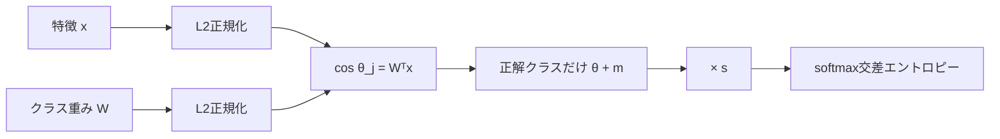

# ArcFace

顔認識モデルを学習するときに使う損失関数。正式名は "Additive Angular Margin Loss"。著者はJiankang Deng、Jia Guo、Niannan Xue、Stefanos Zafeiriou。arXivでの初出は2018年1月（1801.07698）、採録はCVPR 2019。[[insightface]] プロジェクトから出てきた手法で、公式実装もInsightFaceのリポジトリ（`recognition/arcface_torch`）にある。

## 何を解決するか

顔認識では、学習時に見ていない人どうしについて「同じ人か」を判定する必要がある。そのため、各人物の画像を分類できるだけでは足りない。ネットワークの出す特徴ベクトル（埋め込み）が、同じ人どうしでは近く、違う人どうしでは遠くなるように学習させたい。

普通のsoftmax交差エントロピーは、クラスを分ける境界さえ引ければ損失が下がる。そのため、クラス内のばらつきを小さくする力が弱い。ArcFaceはsoftmaxをベースにしたまま、「正解クラスとの角度に余白（マージン）を足す」という1点を変えて、クラス内をより密に、クラス間をより離れさせる。

## 仕組み

1. 特徴ベクトル `x_i` と、最終全結合層の各クラスの重み `W_j` を、どちらもL2正規化して長さ1にする。
2. するとロジット `W_jᵀ x_i` は、2つのベクトルのなす角のコサイン `cos θ_j` と等しくなる。
3. 正解クラス `y_i` の角度にだけ、マージン `m` を足して `cos(θ_{y_i} + m)` にする。
4. すべてのロジットにスケール `s` を掛け、普通のsoftmax交差エントロピーに流す。

```
                  exp(s·cos(θ_{y_i} + m))
L = -log ─────────────────────────────────────────────────
          exp(s·cos(θ_{y_i} + m)) + Σ_{j≠y_i} exp(s·cos θ_j)
```



公式実装の `ArcFace` クラスのデフォルト値は `s=64.0`、`margin=0.5`。処理は、ロジットを `arccos` で角度に戻し、正解クラスに `margin` を足し、`cos` に戻して `s` 倍する、という素直な流れになっている。

## 幾何学的な意味

正規化した埋め込みは単位超球面の上に乗る。2点の角度は、球面上でその2点を結ぶ最短の弧（測地距離）の長さそのもの。論文はこの対応関係を強調している。「角度」に直接マージンを足すことで、超球面上の測地距離に対してマージンを最適化できる、というのが名前（Arc）の由来になっている。

## SphereFace・CosFaceとの関係

角度ベースのマージン損失は、次の一般形でまとめられる。

```
cos(m1·θ + m2) - m3
```

| 手法 | マージンのかけ方 | パラメータ |
|---|---|---|
| SphereFace | 角度に掛け算（乗算角マージン） | `m1 > 1` |
| ArcFace | 角度に足し算（加算角マージン） | `m2`（例: 0.5） |
| CosFace | コサインから引き算（加算コサインマージン） | `m3`（例: 0.4） |

公式実装には、この一般形をそのまま実装した `CombinedMarginLoss(s, m1, m2, m3)` がある。設定ファイルでは `margin_list = (1.0, 0.5, 0.0)` のように `(m1, m2, m3)` を渡す。この値はArcFaceに相当する。`losses.py` の `CosFace` クラスのデフォルトは `s=64.0, m=0.40`。

## 学習データと結果

- 論文では、MS-Celeb-1Mをクリーニングした「MS1MV2」（約8.7万人、約580万枚）でResNet100を学習している。現在の公式実装は、MS1MV3、Glint360K、WebFace42Mなど、より大きいデータセットにも対応している。
- LFWの検証精度は、MS1MV2 + ResNet100で99.83%（ibugが公開している版の論文の表）。別の版の表では99.82%となっており、版によって少し数値が違う。

## 派生

- **Sub-center ArcFace**（ECCV 2020）: 1クラスに複数の中心（sub-center）を持たせ、ノイズの多いデータに強くした拡張。
- **Partial FC**（CVPR 2022）: クラス数が膨大なとき、全結合層の一部のクラスだけをサンプリングして計算する手法。メモリと計算量を減らす。

## 出典

- [ArcFace: Additive Angular Margin Loss for Deep Face Recognition（arXiv 1801.07698）](https://arxiv.org/abs/1801.07698)
- [CVPR 2019 Open Access版PDF](https://openaccess.thecvf.com/content_CVPR_2019/papers/Deng_ArcFace_Additive_Angular_Margin_Loss_for_Deep_Face_Recognition_CVPR_2019_paper.pdf)
- [ibug（Imperial College）公開版PDF](https://ibug.doc.ic.ac.uk/media/uploads/documents/arcface.pdf)
- [IEEE Xplore](https://ieeexplore.ieee.org/abstract/document/8953658)
- [insightface/recognition/arcface_torch/losses.py](https://github.com/deepinsight/insightface/blob/master/recognition/arcface_torch/losses.py)
- [insightface/recognition/arcface_torch/configs/ms1mv3_r100.py](https://github.com/deepinsight/insightface/blob/master/recognition/arcface_torch/configs/ms1mv3_r100.py)
- [insightface/recognition/arcface_torch/README.md](https://github.com/deepinsight/insightface/blob/master/recognition/arcface_torch/README.md)

#face-recognition #deep-learning #metric-learning
