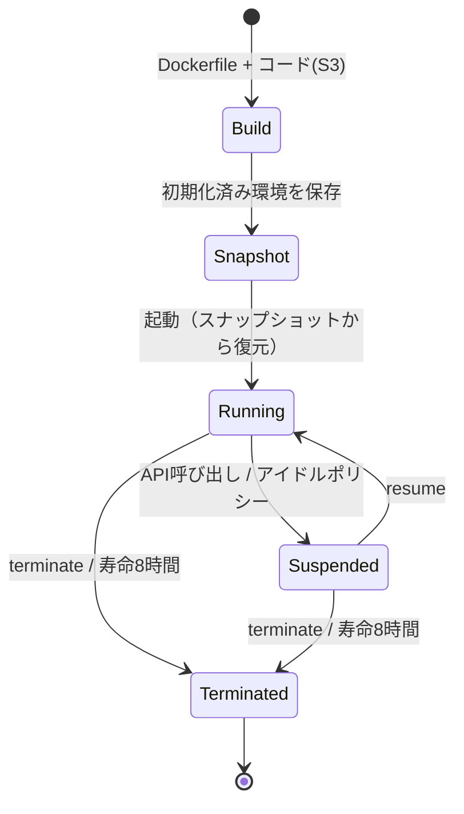

# AWS Lambda MicroVMs

2026-06-22に発表されたLambdaのフォームファクタ。ユーザーが書いたコードやAI生成コードのような信頼できないコードを、VMレベルで分離された**ステートフルな環境**で動かすためのもの。リクエストごとにスケールする関数ではなく、「1セッションに1台のVM」を自分で起動・一時停止・再開・終了する。

## 仕組み

- Lambda関数と同じFirecracker上で動く。OSの機能をフルに使える
- DockerfileとコードのzipをS3に置いて渡すと、LambdaがDockerfileを実行してアプリを起動し、**初期化済みの環境をスナップショット**として保存する
- 以降の起動はコールドブートではなくこのスナップショットから復元するので、起動・再開がほぼ即時
- MicroVMごとに専用のHTTPSエンドポイントがあり、VM内の個々のポートに外から接続できる

## ライフサイクル

- suspend / resume / terminate をAPIで明示的に、またはアイドルポリシーで自動的に行える
- 寿命は1台あたり最大8時間。実行中と一時停止中の時間の合計
- 一時停止中はメモリとディスクの状態が保持され、ストレージ料金だけかかる（コンピュート料金はかからない）
- スナップショットから復元する方式なので、初期化時に一意な値を生成する・ネットワーク接続を張る・一時データを読み込むようなアプリは、サービスが提供するフックで復元後に作り直す必要がある（認証情報や接続の再取得など）

## スペックと提供範囲（ローンチ時点）

- ARM64のみ
- 1台あたり最大16 vCPU、メモリ32GB、ディスク32GB
- リージョン: US East（バージニア北部、オハイオ）、US West（オレゴン）、欧州（アイルランド）、アジアパシフィック（東京）

## 課金

- インスタンス秒単位
- 課金軸は、コンピュート（ベースラインとピークの使用量に基づく秒単位）、スナップショット操作とストレージ、データ転送の3つ

## ユースケース

公式が挙げているもの:

- AIエージェントのコード実行サンドボックス（OpenAI Agents APIのサンドボックスとして使うガイドもある）
- 対話的な開発環境
- データ分析
- セキュリティスキャン
- CI/CD

イベント駆動・リクエスト/レスポンス型の処理は引き続き [[aws-lambda-event-functions]] の領分とされている。

## [[aws-lambda]]の中での位置づけ

Lambdaの3形態のうち唯一、リクエスト単位ではなくセッション単位で環境を割り当て、状態と寿命を利用者が直接コントロールする形態。

## 出典

- [AWS introduces Lambda MicroVMs for isolated execution of user and AI-generated code - AWS（What's New）](https://aws.amazon.com/about-aws/whats-new/2026/06/aws-lambda-microvms/)
- [Run isolated sandboxes with full lifecycle control: AWS Lambda introduces MicroVMs - AWS News Blog](https://aws.amazon.com/blogs/aws/run-isolated-sandboxes-with-full-lifecycle-control-aws-lambda-introduces-microvms/)
- [Announcing Lambda MicroVMs: serverless compute environments with VM-level isolation and near-instant startup - AWS Compute Blog](https://aws.amazon.com/blogs/compute/announcing-lambda-microvms-serverless-compute-environments-with-vm-level-isolation-and-near-instant-startup/)
- [AWS Lambda MicroVMs - AWS Lambda Developer Guide](https://docs.aws.amazon.com/lambda/latest/dg/lambda-microvms-guide.html)
- [Using Lambda MicroVMs as a sandbox for OpenAI Agents API - AWS Lambda Developer Guide](https://docs.aws.amazon.com/lambda/latest/dg/microvms-integrations-openai-agents-api.html)
- [AWS Lambda MicroVMs - AWS](https://aws.amazon.com/lambda/lambda-microvms/)
- [AWS Lambda Pricing](https://aws.amazon.com/lambda/pricing/)
- [AWS Lambda FAQs](https://aws.amazon.com/lambda/faqs/)

#aws #serverless #lambda #sandbox
