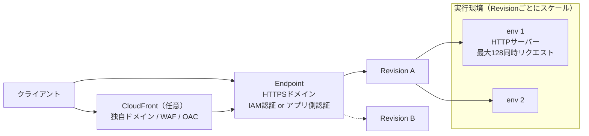

# AWS Lambda Web Functions

2026-10-12に発表された、Lambdaの新しいフォームファクタ。ハンドラ関数でイベントを受け取る従来型（[[aws-lambda-event-functions]]）と違い、**ポートをlistenする普通のHTTPサーバー**をそのままLambda上で動かす。Express / Hono / React Router などのWebフレームワークがアダプタなしで動く。

発表と同時に、既存のLambda関数は「Lambda Event Functions」に改名された（名前だけの変更）。

## Event Functionsとの違い

| | Event Functions（従来） | Web Functions |
| --- | --- | --- |
| プログラミングモデル | イベントを受け取るハンドラ関数 | ポートをlistenするHTTPサーバー |
| 1実行環境あたりの同時処理 | 1リクエスト | 複数（デフォルト64、1〜128で設定可） |
| 課金 | 実行時間（wall-clock）× メモリ | アクティブCPU時間 + 実行環境の生存期間中のメモリ + リクエスト数 + データ転送 |
| 呼び出し方 | Invoke API、各種イベントソース（SQS / S3 / API Gateway等） | エンドポイントのHTTPSドメインに直接HTTPリクエスト |
| 1リクエストの最大時間 | 15分 | 15分（デフォルト30秒） |
| ランタイム（ローンチ時点） | 多数 | Node.js 24（`nodejs24.x`）、Arm64のみ |

公式ドキュメントの使い分けは「HTTPトラフィックを直接受けて返すワークロードはWeb Functions、キューのメッセージやファイルアップロードなどのイベント駆動処理はEvent Functions」。

## 構成要素

- **Revision**: コードと設定の不変スナップショット
- **Endpoint**: HTTPリクエストを1つまたは2つのrevisionにルーティングする（2つに振り分けられる＝段階的な切り替えに使える）。各endpointはTLS付きのHTTPSドメインを持つ
- **実行環境**: 1つの実行環境が複数の同時リクエストを処理し、トラフィックに応じてLambdaが実行環境の数をスケールさせる

## 課金モデル

- CPUを実際に使った時間だけ課金される。DBクエリや外部API呼び出しの待ち時間はCPUをほぼ使わないので、I/O待ちが多いWebアプリほど安くなる
- 一方でメモリは実行環境が存在する間ずっと課金される（リクエスト間のアイドル中も含む）
- 1環境で多数のリクエストをさばくので、Event Functionsの「1リクエスト＝1環境」より環境数・コールドスタートが減る

## スケーリングと制御

- トラフィックがなくなるとアイドルな実行環境は削除され（scale to zero）、リクエストが来たら作り直される。その間リクエストは初期化待ちになりうる（コールドスタート）
- endpointごとにリクエストレート上限（RPS）、最大実行環境数（`maxEnvironments`）を設定できる。どちらもリージョンごとに適用
- 1環境あたりの同時リクエスト数は `maxConcurrencyPerEnvironment`（デフォルト64、1〜128）

## 認証・公開まわり

- endpointごとにIAM認証かアプリ側で認証するかを選ぶ
- 独自ドメインやAWS WAFを使いたい場合は前段にCloudFrontを置く。CloudFrontがWeb Functionsをオリジンとしてサポートし、Origin Access Control（OAC）でCloudFront経由でしか到達できないように制限できる
- VPC接続に対応
- 複数リージョンにデプロイすると、単一URLでレイテンシが最も低いリージョンにベストエフォートでルーティングされる

## 提供リージョン（ローンチ時点）

US East（バージニア北部）、US East（オハイオ）、US West（オレゴン）、アジアパシフィック（東京）、欧州（アイルランド）。

## Lambdaの3つのフォームファクタ

発表時点でLambdaは Event Functions / Web Functions / MicroVMs の3形態を持つと説明されている。いずれもFirecracker上で動き、VMレベルの分離を持つ。

- **Event Functions**: イベント駆動、1環境1リクエスト、wall-clock課金
- **Web Functions**: HTTPサーバー、1環境で多数の同時リクエスト、アクティブCPU課金
- **MicroVMs**: 信頼できないコード・AI生成コード向けのステートフルなサンドボックス。Dockerfileベースで、1セッション1環境、最大8時間

## 出典

- [AWS Lambda、Lambda Web Functions を発表 - AWS（What's New、日本語）](https://aws.amazon.com/jp/about-aws/whats-new/2026/10/aws-lambda-web-functions/)
- [AWS Lambda announces Lambda Web Functions - AWS（What's New）](https://aws.amazon.com/about-aws/whats-new/2026/10/aws-lambda-web-functions/)
- [Announcing AWS Lambda Web Functions - AWS News Blog](https://aws.amazon.com/blogs/aws/announcing-aws-lambda-web-functions-for-fast-consistent-web-app-performance-anywhere/)
- [AWS Lambda Web Functions - AWS Lambda Developer Guide](https://docs.aws.amazon.com/lambda/latest/dg/web-functions.html)
- [Serverless compute for HTTP workloads - AWS Lambda Web Functions](https://aws.amazon.com/lambda/lambda-web-functions/)
- [Lambda quotas - AWS Lambda](https://docs.aws.amazon.com/lambda/latest/dg/gettingstarted-limits.html)
- [Amazon CloudFront now supports AWS Lambda Web Functions as an origin - AWS（What's New）](https://aws.amazon.com/about-aws/whats-new/2026/10/cloudfront-lambda-web-functions-origin/)
- [Run isolated sandboxes with full lifecycle control: AWS Lambda introduces MicroVMs - AWS News Blog](https://aws.amazon.com/blogs/aws/run-isolated-sandboxes-with-full-lifecycle-control-aws-lambda-introduces-microvms/)

#aws #serverless #lambda
