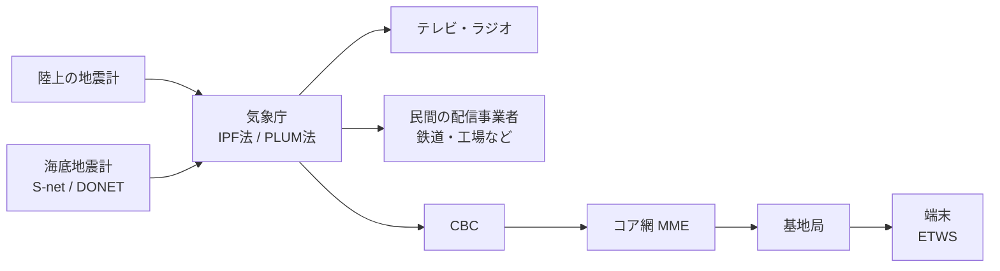

# 緊急地震速報

気象庁が出している、強い揺れが来る前に「もうすぐ揺れる」と知らせる仕組み。英語では Earthquake Early Warning（EEW）。ソフトウェアの言葉で言えば「**速い信号（P波）で遅い本体（S波）の到着を先回りして知らせる**」ストリーム処理システム。

## 物理的な前提：P波とS波の速度差

地震が起きると、性質の違う2種類の波が同時に出る。

| 波 | 速度（目安） | 性質 |
|---|---|---|
| P波（Primary） | 約7 km/s | 速い、揺れは小さい |
| S波（Secondary） | 約4 km/s | 遅い、大きな被害を出す主な揺れ |

震源の近くの地震計でP波を捉えて計算し、結果をネットワーク経由で配れば、遠くの地点にはS波より先に届く。システム全体は「データ伝送はS波より圧倒的に速い」という非対称を使ったレースだと言える。

震源から距離 d km の地点で使える猶予はざっくり次のとおり。

```
猶予 ≈ d/4 − d/7 − (検知・計算・配信のレイテンシ)
```

震源の真上に近い地点では右辺がマイナスになり、速報が間に合わない（ブラインドゾーン）。これは仕組み上なくせない制約。

## 全体のデータフロー



## 入力：地震計ネットワーク

陸上の地震計網に加えて、2019年6月から海底地震計網の S-net（日本海溝沿い）と DONET（南海トラフ沿い）も使われている。海で起きる地震は、震源に近い海底でP波を拾えるぶん早く出せる。

各観測点はP波の検出や振幅の計測をある程度その場でやってからデータを送る。生の波形をすべて中央に集めるのではなく、エッジで前処理してから集める構成。

## 処理：2つの予測手法を並べて走らせる

気象庁は性質の違う2つの手法を同時に動かし、**予測震度の大きいほうを採用**している。

### IPF法：震源を推定してから予測する

- 複数の観測点のデータから震源の位置とマグニチュードを推定し、距離による揺れの減衰を考えて各地の震度を計算する
- IPF は Integrated Particle Filter の略。粒子フィルタ（仮説をたくさん持ったまま、観測が届くたびに更新するベイズ推定）を使うので、ほぼ同時に起きた複数の地震を分けて扱える
- 2016年12月14日に運用開始。それ以前は、同時に起きた地震を1つの大きな地震と誤認して過大な予報を出すことがあった

### PLUM法：震源を推定しない

- 震源やマグニチュードは計算しない。「ある地点で強く揺れたら、その周り（半径30km以内）もすぐ同じくらい揺れる」というルールで、実際に観測された揺れから予測する
- 2018年3月に導入
- 2011年の東北地方太平洋沖地震のように、断層が長い範囲にわたって壊れる巨大地震では「震源は1点」という前提が崩れ、震源から計算する方法ではマグニチュードを小さく見積もってしまう。PLUM法はモデルの前提に頼らないので、こういう地震でも予測震度の精度が高い
- その代わり、実際に揺れてから予測するので猶予は短くなる

精度は高いが前提が崩れると壊れるモデル（IPF）と、鈍いが頑健なヒューリスティック（PLUM）を並べて走らせ、`max()` で合わせる。外したときの被害が大きいほうを避ける、安全側に倒した冗長化になっている。

## 出力：何度も更新されるストリーム

同じ地震について第1報、第2報…と何度も更新されて流れる。

- 最初は少ない観測点の情報だけで、とにかく速く出す
- 観測点が増えるたびに推定が収束し、続報で予測が修正される
- 誤検知だと分かれば取り消しの報が出る

速さと正確さを交換している設計で、結果整合性（eventual consistency）に近い。受け取る側は報の番号を見て古い報を捨て、最新の状態で上書きすることになる。

区分は大きく2つ。

- **警報**（スマホが鳴るもの）：地震波が2点以上の観測点で観測され、最大震度5弱以上または最大長周期地震動階級3以上が予想されたときに出る。強い揺れ（震度4以上または長周期地震動階級3以上）が予想される地域名を伝え、具体的な予測震度や猶予時間は含まない。うち震度6弱以上または長周期地震動階級4が予想されるものは特別警報の扱い
- **予報**：マグニチュード3.5以上、または最大震度3以上もしくは最大長周期地震動階級1以上が予想されたときに出る。地域ごとの予測震度や主要動の到達予想時刻も含む。主に事業者向けで、鉄道の自動停止のように機械が自動で反応する用途で使われる
- 長周期地震動階級の基準は2023年2月1日に追加された

警報で「2点以上」を条件にしているのは、地震計の近くに雷が落ちたときなどの誤報を避けるため。1つのセンサーの値だけで動かず、複数のセンサーが同じことを言ったときだけ動く、という考え方。

## 配信：スマホに数秒で届く理由

スマホへの経路は次のとおり。

```
気象庁 → CBC (Cell Broadcast Center) → MME などのコア網 → 対象エリアの基地局 → 端末
```

使われているのは 3GPP で標準化された ETWS（Earthquake and Tsunami Warning System）。土台は Cell Broadcast Service（CBS）で、基地局のエリア（セル）内にいる端末すべてに一斉に情報を届ける。

- 端末ごとに送るユニキャストではなくブロードキャストなので、端末の数が増えても負荷は変わらず、通信が混み合っても影響を受けない
- 電話番号やアカウントを知らなくても、そのエリアにいる端末すべてに届く
- 短い**第1報**を先に送り、詳しい内容は**第2報**で送る二段構え。第1報は小さいので一度で受け取れ、仕様上は約4秒で届くことを目標にしている

APNs や FCM のような普通のプッシュ通知は「サーバーから各端末へ」送るので、数千万台に一斉に送るとどうしても詰まる。ETWS は無線レイヤーのブロードキャストを使うので、この問題が起きない。

## 設計上のトレードオフ

| 論点 | 緊急地震速報の選択 |
|---|---|
| 速さ vs 正確さ | 速さを優先し、続報で修正する |
| センサーの誤検知 | 警報は2点以上の観測を条件にする |
| モデルの前提が崩れたとき | 前提の違う2手法を並べて走らせ、大きいほうを採る |
| 複数の地震が同時に起きたとき | 粒子フィルタで複数の仮説を持ち続ける |
| 一斉配信のスケール | ユニキャストをやめてセルブロードキャストにする |
| どうしても無理な部分 | ブラインドゾーン（物理的に間に合わない） |

## 出典

- [気象庁｜緊急地震速報の仕組み](https://www.jma.go.jp/jma/kishou/know/jishin/eew/shikumi/shikumi.html)
- [気象庁 緊急地震速報評価・改善検討会 資料（令和元年度）](https://www.jma.go.jp/jma/kishou/shingikai/jishin/eew-hyoka/r01/shiryou2.pdf)
- [気象庁｜緊急地震速報（警報）及び（予報）について](https://www.jma.go.jp/jma/kishou/know/jishin/eew/shikumi/shousai.html)
- [気象庁｜緊急地震速報の発表基準の変更について](https://www.jma.go.jp/jma/kishou/know/jishin/eew/lpgm_start/lpgm_start.html)
- [ケータイ Watch「ETWS とは」](https://k-tai.watch.impress.co.jp/docs/column/keyword/498122.html)
- [NTTドコモ テクニカル・ジャーナル Vol.17 No.3](https://www.docomo.ne.jp/binary/pdf/corporate/technology/rd/technical_journal/bn/vol17_3/vol17_3_021jp.pdf)

#earthquake #disaster-prevention #distributed-systems #streaming #network
