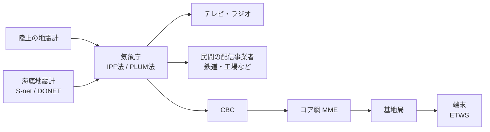
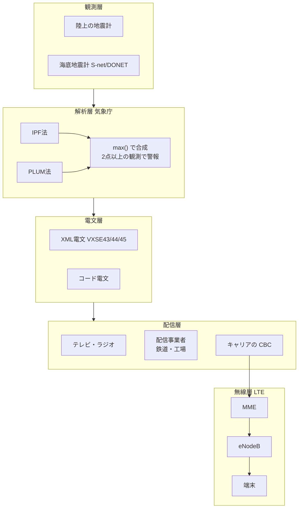
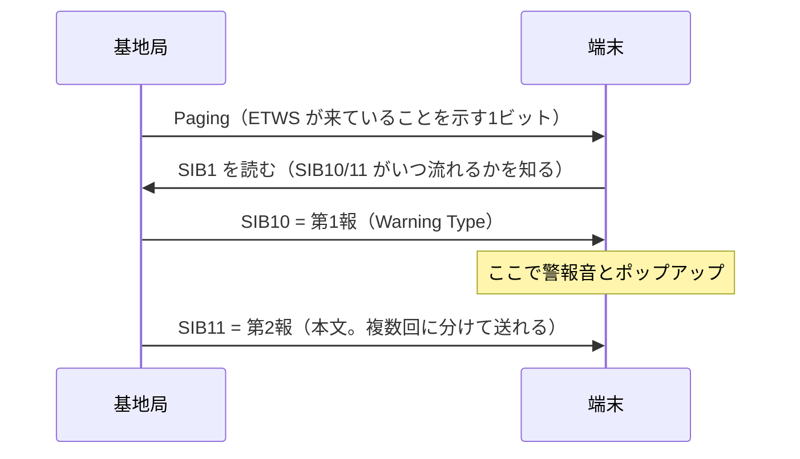

# 緊急地震速報

気象庁が出している、強い揺れが来る前に「もうすぐ揺れる」と知らせる仕組み。英語では Earthquake Early Warning（EEW）。ソフトウェアの言葉で言えば「**速い信号（P波）で遅い本体（S波）の到着を先回りして知らせる**」ストリーム処理システム。

## 物理的な前提：P波とS波の速度差

地震が起きると、性質の違う2種類の波が同時に出る。

| 波 | 速度（目安） | 性質 |
|---|---|---|
| P波（Primary） | 約7 km/s | 速い、揺れは小さい |
| S波（Secondary） | 約4 km/s | 遅い、大きな被害を出す主な揺れ |

震源の近くの地震計でP波を捉えて計算し、結果をネットワーク経由で配れば、遠くの地点にはS波より先に届く。システム全体は「データ伝送はS波より圧倒的に速い」という非対称を使ったレースだと言える。

震源から距離 d km の地点で使える猶予はざっくり次のとおり。

```
猶予 ≈ d/4 − d/7 − (検知・計算・配信のレイテンシ)
```

震源の真上に近い地点では右辺がマイナスになり、速報が間に合わない（ブラインドゾーン）。これは仕組み上なくせない制約。

## 全体のデータフロー



## 入力：地震計ネットワーク

陸上の地震計網に加えて、2019年6月から海底地震計網の S-net（日本海溝沿い）と DONET（南海トラフ沿い）も使われている。海で起きる地震は、震源に近い海底でP波を拾えるぶん早く出せる。

各観測点はP波の検出や振幅の計測をある程度その場でやってからデータを送る。生の波形をすべて中央に集めるのではなく、エッジで前処理してから集める構成。

## 処理：2つの予測手法を並べて走らせる

気象庁は性質の違う2つの手法を同時に動かし、**予測震度の大きいほうを採用**している。

### IPF法：震源を推定してから予測する

- 複数の観測点のデータから震源の位置とマグニチュードを推定し、距離による揺れの減衰を考えて各地の震度を計算する
- IPF は Integrated Particle Filter の略。粒子フィルタ（仮説をたくさん持ったまま、観測が届くたびに更新するベイズ推定）を使うので、ほぼ同時に起きた複数の地震を分けて扱える
- 2016年12月14日に運用開始。それ以前は、同時に起きた地震を1つの大きな地震と誤認して過大な予報を出すことがあった

### PLUM法：震源を推定しない

- 震源やマグニチュードは計算しない。「ある地点で強く揺れたら、その周り（半径30km以内）もすぐ同じくらい揺れる」というルールで、実際に観測された揺れから予測する
- 2018年3月に導入
- 2011年の東北地方太平洋沖地震のように、断層が長い範囲にわたって壊れる巨大地震では「震源は1点」という前提が崩れ、震源から計算する方法ではマグニチュードを小さく見積もってしまう。PLUM法はモデルの前提に頼らないので、こういう地震でも予測震度の精度が高い
- その代わり、実際に揺れてから予測するので猶予は短くなる

精度は高いが前提が崩れると壊れるモデル（IPF）と、鈍いが頑健なヒューリスティック（PLUM）を並べて走らせ、`max()` で合わせる。外したときの被害が大きいほうを避ける、安全側に倒した冗長化になっている。

## 出力：何度も更新されるストリーム

同じ地震について第1報、第2報…と何度も更新されて流れる。

- 最初は少ない観測点の情報だけで、とにかく速く出す
- 観測点が増えるたびに推定が収束し、続報で予測が修正される
- 誤検知だと分かれば取り消しの報が出る

速さと正確さを交換している設計で、結果整合性（eventual consistency）に近い。受け取る側は報の番号を見て古い報を捨て、最新の状態で上書きすることになる。

区分は大きく2つ。

- **警報**（スマホが鳴るもの）：地震波が2点以上の観測点で観測され、最大震度5弱以上または最大長周期地震動階級3以上が予想されたときに出る。強い揺れ（震度4以上または長周期地震動階級3以上）が予想される地域名を伝え、具体的な予測震度や猶予時間は含まない。うち震度6弱以上または長周期地震動階級4が予想されるものは特別警報の扱い
- **予報**：マグニチュード3.5以上、または最大震度3以上もしくは最大長周期地震動階級1以上が予想されたときに出る。地域ごとの予測震度や主要動の到達予想時刻も含む。主に事業者向けで、鉄道の自動停止のように機械が自動で反応する用途で使われる
- 長周期地震動階級の基準は2023年2月1日に追加された

警報で「2点以上」を条件にしているのは、地震計の近くに雷が落ちたときなどの誤報を避けるため。1つのセンサーの値だけで動かず、複数のセンサーが同じことを言ったときだけ動く、という考え方。

## 配信：スマホに数秒で届く理由

スマホへの経路は次のとおり。

```
気象庁 → CBC (Cell Broadcast Center) → MME などのコア網 → 対象エリアの基地局 → 端末
```

使われているのは 3GPP で標準化された ETWS（Earthquake and Tsunami Warning System）。土台は Cell Broadcast Service（CBS）で、基地局のエリア（セル）内にいる端末すべてに一斉に情報を届ける。

- 端末ごとに送るユニキャストではなくブロードキャストなので、端末の数が増えても負荷は変わらず、通信が混み合っても影響を受けない
- 電話番号やアカウントを知らなくても、そのエリアにいる端末すべてに届く
- 短い**第1報**を先に送り、詳しい内容は**第2報**で送る二段構え。第1報は小さいので一度で受け取れ、仕様上は約4秒で届くことを目標にしている

APNs や FCM のような普通のプッシュ通知は「サーバーから各端末へ」送るので、数千万台に一斉に送るとどうしても詰まる。ETWS は無線レイヤーのブロードキャストを使うので、この問題が起きない。

## アーキテクチャ（レイヤー構成）



- 観測層：観測点でP波の検出や振幅の計測をしてから送る
- 解析層：2つの手法の結果を合わせて、発表するかどうかを決める
- 電文層：同じ内容を、機械向けの決まった形式（XML とコード電文）にする
- 配信層：行政機関に届ける経路は、通信事業者の回線に加えて中央防災無線網を第二ルートにして二重化している（2008年の内閣府資料の時点）
- 無線層：セルブロードキャストで一斉に配る（後述）

## 電文のデータ構造（気象庁防災情報XML）

電文の種類は次のとおり。

| 電文 | 内容 |
|---|---|
| VXSE43 | 緊急地震速報（警報） |
| VXSE44 | 緊急地震速報（予報） |
| VXSE45 | 緊急地震速報（地震動予報）。長周期地震動を扱う新しい形式 |
| VXSE47 | リアルタイム震度 |

JMAXML の電文は、管理部（Control）・ヘッダ部（Head）・内容部（Body）の3つに分かれる。緊急地震速報でおさえておきたい要素は以下（細かい定義は気象庁の解説資料を参照）。

```
Report
├─ Control       … 電文の種類、発表日時、発表した官署など
├─ Head
│   ├─ EventID   … 地震識別番号。同じ地震の電文はこの値でまとまる
│   ├─ Serial    … 報の番号。新しい地震の最初の電文は 1
│   ├─ InfoType  … 発表 / 取消 など
│   └─ Headline/Information … 警報と地震動予報だけに出る（強い揺れが予想される地域）
└─ Body
    ├─ Earthquake … 発生時刻、震源（Hypocenter）、マグニチュード
    ├─ Intensity  … 予測最大震度、地域ごとの予測震度や主要動の到達予想時刻
    ├─ Text
    └─ NextAdvisory … 最終報のとき「この情報をもって、緊急地震速報：最終報とします。」が入る
```

ソフトウェアの言葉で言い換えると次のようになる。

- `EventID` が集約のキー、`Serial` がバージョン番号。受け取る側は `EventID` ごとに最新の状態を持ち、`Serial` が古い電文は捨てる（upsert）
- `InfoType=取消` は削除の印（tombstone）。このとき Body 直下の Earthquake や Intensity などは Text を除いて出てこないので、パースするときは注意がいる
- `NextAdvisory` はストリームの終わりの印
- 震源の推定がまだできていないときは「仮定震源要素」（深さ 10km・M1.0 で固定）が入り、`Condition` タグで補足される。値をそのまま本物の震源として使ってはいけない
- 落とし穴：`EventID` は発表した官署やシステムの状況によって一貫しないことがあり、値そのものに発生時刻などの物理的な意味はないとされている

昔からある**コード電文**（固定長のテキスト形式）もあり、先頭の電文種別番号で中身を見分ける。たとえば 35 は最大予測震度だけ、37 はマグニチュード・最大予測震度・主要動到達予測時刻を含むもの、39 は取消。

## 無線層のデータ構造（ETWS）

CBC から MME へは Write-Replace-Warning-Request というメッセージで警報を渡す。主な項目は次のとおり。

| 項目 | 役割 |
|---|---|
| Message Identifier | 警報の種類。ETWS の地震は 4352（0x1100）、津波 4353、地震と津波 4354、テスト 4355 |
| Serial Number | 同じ警報の版を区別する番号 |
| List of TAIs | MME だけが使う。どの基地局に送るかを選ぶ |
| Warning Area List | 基地局だけが使う。自分のセルが対象かを判定する |
| Warning Type | 第1報（Primary Notification）の中身 |
| Repetition Period / No-of-Broadcasts-Requested | 繰り返し送る間隔と回数。第1報では無視される |

- 1つの基地局が複数の MME から同じ警報を受け取ることがある。基地局は `Message Identifier` と `Serial Number` の組で重複を見つけて、最初の1つだけを流す。冪等キーで重複を除くのと同じ発想
- Warning Type は 7ビットの値（0=地震、1=津波、2=地震と津波、3=テスト、4=その他）に、端末で警報音を鳴らすかやポップアップを出すかを決めるフラグが付いた小さな構造

端末側の受信の流れ：



Paging で「来ているよ」とだけ知らせ、端末が自分から読みにいく。サーバーが中身を一斉に押しつけるのではなく、小さな通知と読みにいく動き（pull）の組み合わせになっている。

## 設計上のトレードオフ

| 論点 | 緊急地震速報の選択 |
|---|---|
| 速さ vs 正確さ | 速さを優先し、続報で修正する |
| センサーの誤検知 | 警報は2点以上の観測を条件にする |
| モデルの前提が崩れたとき | 前提の違う2手法を並べて走らせ、大きいほうを採る |
| 複数の地震が同時に起きたとき | 粒子フィルタで複数の仮説を持ち続ける |
| 一斉配信のスケール | ユニキャストをやめてセルブロードキャストにする |
| 更新と取消の扱い | EventID + Serial で版を管理し、取消は削除の印で表す |
| 重複して届く | Message Identifier + Serial Number で重複を除く |
| どうしても無理な部分 | ブラインドゾーン（物理的に間に合わない） |

## 出典

- [気象庁｜緊急地震速報の仕組み](https://www.jma.go.jp/jma/kishou/know/jishin/eew/shikumi/shikumi.html)
- [気象庁 緊急地震速報評価・改善検討会 資料（令和元年度）](https://www.jma.go.jp/jma/kishou/shingikai/jishin/eew-hyoka/r01/shiryou2.pdf)
- [気象庁｜緊急地震速報（警報）及び（予報）について](https://www.jma.go.jp/jma/kishou/know/jishin/eew/shikumi/shousai.html)
- [気象庁｜緊急地震速報の発表基準の変更について](https://www.jma.go.jp/jma/kishou/know/jishin/eew/lpgm_start/lpgm_start.html)
- [ケータイ Watch「ETWS とは」](https://k-tai.watch.impress.co.jp/docs/column/keyword/498122.html)
- [NTTドコモ テクニカル・ジャーナル Vol.17 No.3](https://www.docomo.ne.jp/binary/pdf/corporate/technology/rd/technical_journal/bn/vol17_3/vol17_3_021jp.pdf)
- [地震火山関連XML 電文解説資料（令和7年12月、気象庁地震火山部）](https://dmdata.jp/docs/jma/manual/0101-0185.pdf)
- [気象庁防災情報XML フォーマット Ver.1.2](https://xml.kishou.go.jp/jmaxml_20160331_format_v1_2.pdf)
- [新しい予想手法の導入に伴う緊急地震速報XML電文の変更点（平成29年7月、気象庁）](https://www.data.jma.go.jp/eew/data/nc/shiryo/setsumeikai170712/170712_3b.pdf)
- [緊急地震速報 コード電文の資料（気象庁）](https://www.data.jma.go.jp/eew/data/nc/shiryo/setsumeikai170712/170712_3e.pdf)
- [気象庁防災情報 XML（地震分野）を処理する際のメモ - Qiita](https://qiita.com/oruponu/items/883e4db5f023d7f76ffc)
- [内閣府 中央防災無線網による緊急地震速報の伝達（2008年）](https://www.bousai.go.jp/jishin/eew/dai6kai/20080311siryo7chubomusen.pdf)
- [3GPP TS 23.041 9.2.16 WRITE-REPLACE-WARNING-REQUEST（iTecSpec）](https://itecspec.com/3gpp/23.041/s/9.2.16)
- [3GPP TS 23.041 9.3.24 Warning-Type（iTecSpec）](https://itecspec.com/3gpp/23.041/s/9.3.24)
- [3GPP C1-224590 CBS Message Ids](https://3gpp.org/ftp/tsg_CT/WG1_mm-cc-sm_ex-CN1/TSGC1_137e/Inbox/Drafts/C1-224590_rev1%20CBS%20Message%20Ids%20for%20additional%20KPAS%20services.docx)
- [US9985734（ETWS の Paging と SIB10/SIB11 の流れ）](https://patents.google.com/patent/US9985734)

#earthquake #disaster-prevention #distributed-systems #streaming #network
