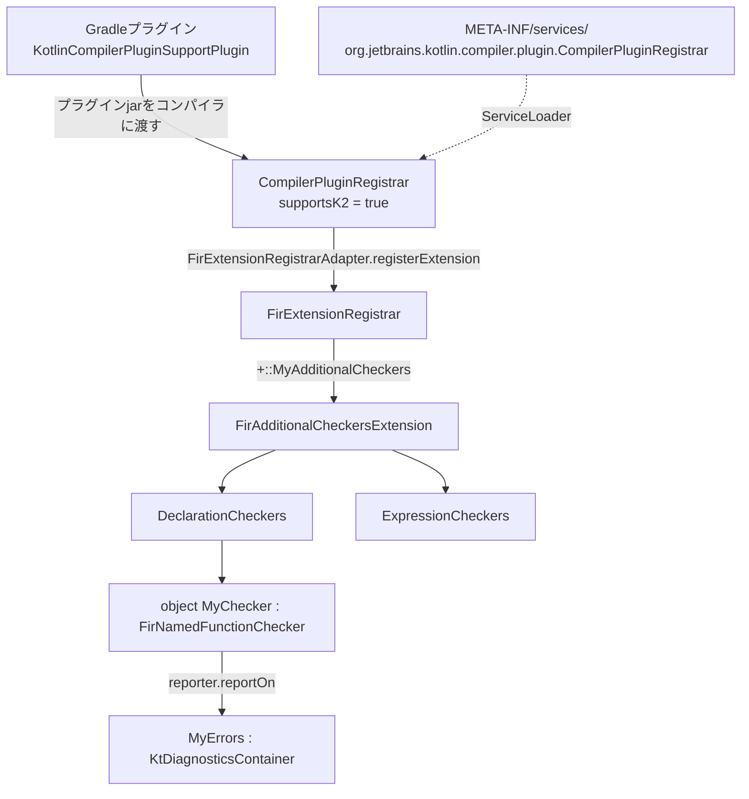

# FirAdditionalCheckersExtension

K2コンパイラプラグインから独自の [[fir-checker]] を追加するためのFIR拡張ポイント。ここに登録したCheckerは、組み込みのCheckerと同じタイミング（`BODY_RESOLVE` 後のdiagnostic収集）で走る。FIRで報告したdiagnosticは、コンパイル時だけでなくIDEのハイライトにも出る。

```kotlin
abstract class FirAdditionalCheckersExtension(session: FirSession) : FirExtension(session) {
    open val declarationCheckers: DeclarationCheckers = DeclarationCheckers.EMPTY
    open val expressionCheckers: ExpressionCheckers = ExpressionCheckers.EMPTY
    open val typeCheckers: TypeCheckers = TypeCheckers.EMPTY
    open val languageVersionSettingsCheckers: LanguageVersionSettingsCheckers = LanguageVersionSettingsCheckers.EMPTY
    // ...
}
```

必要なコンテナだけoverrideして、その中の `xxxCheckers: Set<...>` に自作Checkerを入れる。

## 全体の配線



## 実装手順

例として、Kotlin本体リポジトリの `plugins/plugin-sandbox` を元にしている。`dummy` という名前の関数を警告し、関数呼び出しの引数の符号属性が合わないとエラーにするプラグイン。

### 1. diagnosticを定義する

`KtDiagnosticsContainer` を継承した `object` に、`warning0`〜`warningN` / `error0`〜`errorN` デリゲートでファクトリを定義する。数字は引数の個数、型パラメータはPSI要素の型＋引数の型。メッセージは `BaseDiagnosticRendererFactory` に書く。

```kotlin
object PluginErrors : KtDiagnosticsContainer() {
    val FUNCTION_WITH_DUMMY_NAME by warning1<KtElement, String>(SourceElementPositioningStrategies.DECLARATION_NAME)
    val ILLEGAL_NUMBER_SIGN by error2<KtElement, String, String>()

    override fun getRendererFactory(): BaseDiagnosticRendererFactory = Renderers

    object Renderers : BaseDiagnosticRendererFactory() {
        override val MAP: KtDiagnosticFactoryToRendererMap by KtDiagnosticFactoryToRendererMap("Plugin sandbox errors") {
            it.put(FUNCTION_WITH_DUMMY_NAME, "{0}", TO_STRING)
            it.put(ILLEGAL_NUMBER_SIGN, "{0}, {1}", TO_STRING, TO_STRING)
        }
    }
}
```

`SourceElementPositioningStrategies.DECLARATION_NAME` を渡すと、関数全体のsourceで報告しても、赤線は関数名の上だけに出る。

### 2. Checkerを書く

見たい要素の型に合うChecker型を継承した `object` を作る。`MppCheckerKind` を指定し、`check` は context parameter で `CheckerContext` と `DiagnosticReporter` を受け取る。

```kotlin
object DummyNameChecker : FirNamedFunctionChecker(MppCheckerKind.Common) {
    context(context: CheckerContext, reporter: DiagnosticReporter)
    override fun check(declaration: FirNamedFunction) {
        val name = declaration.name.asString()
        if (name == "dummy") {
            reporter.reportOn(declaration.source, PluginErrors.FUNCTION_WITH_DUMMY_NAME, name)
        }
    }
}
```

式のCheckerも同じ形になる。

```kotlin
object SignedNumberCallChecker : FirFunctionCallChecker(MppCheckerKind.Common) {
    context(context: CheckerContext, reporter: DiagnosticReporter)
    override fun check(expression: FirFunctionCall) {
        val argumentMapping = expression.resolvedArgumentMapping ?: return
        for ([argument, parameter] in argumentMapping.entries) {
            val expectedSign = parameter.returnTypeRef.coneType.attributes.numberSign ?: continue
            val actualSign = argument.resolvedType.attributes.numberSign
            if (expectedSign != actualSign) {
                reporter.reportOn(argument.source, PluginErrors.ILLEGAL_NUMBER_SIGN, expectedSign.asString(), actualSign.asString())
            }
        }
    }
}
```

[[fir-checker]] の契約がそのまま当てはまる。

- ステートレスな `object` にする
- できるだけ具体的な型のCheckerにする
- 子要素を自前で走査せず、その要素用のCheckerを別に書く。こうしないと `@Suppress` が効かない
- 他の宣言の情報はシンボルのアクセサから取る。`symbol.fir` は使わない（IDEの遅延解決で壊れる）

### 3. FirAdditionalCheckersExtensionにまとめる

```kotlin
class PluginAdditionalCheckers(session: FirSession) : FirAdditionalCheckersExtension(session) {
    override val declarationCheckers: DeclarationCheckers = object : DeclarationCheckers() {
        override val namedFunctionCheckers: Set<FirNamedFunctionChecker> = setOf(DummyNameChecker)
    }

    override val expressionCheckers: ExpressionCheckers = object : ExpressionCheckers() {
        override val functionCallCheckers: Set<FirFunctionCallChecker> = setOf(SignedNumberCallChecker)
    }
}
```

### 4. FirExtensionRegistrarに登録する

コンストラクタ参照に単項 `+` を付けて登録するDSL。

```kotlin
class MyFirExtensionRegistrar : FirExtensionRegistrar() {
    override fun ExtensionRegistrarContext.configurePlugin() {
        +::PluginAdditionalCheckers
    }
}
```

特定のアノテーションが付いた宣言だけを見たい場合は、`FirExtension.registerPredicates` で predicate を宣言しておき、`session.predicateBasedProvider` で判定する。predicateを宣言しないと、providerがその宣言を見つけられないことがある。

### 5. CompilerPluginRegistrarで登録し、ServiceLoaderに載せる

```kotlin
class MyComponentRegistrar : CompilerPluginRegistrar() {
    override val pluginId: String get() = "com.example.my-checker"
    override val supportsK2: Boolean get() = true

    override fun ExtensionStorage.registerExtensions(configuration: CompilerConfiguration) {
        FirExtensionRegistrarAdapter.registerExtension(MyFirExtensionRegistrar())
    }
}
```

`resources/META-INF/services/org.jetbrains.kotlin.compiler.plugin.CompilerPluginRegistrar` に実装クラスのFQNを1行書く。オプションを受け取るなら `CommandLineProcessor` も実装し、同じように `META-INF/services/org.jetbrains.kotlin.compiler.plugin.CommandLineProcessor` に書く。

### 6. Gradleから適用する

`KotlinCompilerPluginSupportPlugin` を実装したGradleプラグインを作る。`getCompilerPluginId()`（`pluginId` と一致させる）、`getPluginArtifact()`（コンパイラプラグインjarの座標）、`applyToCompilation()`（`SubpluginOption` のリストを返す）を実装する。公式ドキュメントでも「カスタムコンパイラプラグインの開発は現状Gradleでのみ可能」とされ、`Kotlin/compiler-plugin-template` から始めるのが推奨されている。

### 7. テスト

テンプレートはKotlinコンパイラ本体のテストフレームワークを使う。`testData/diagnostics/*.kt` に、期待するdiagnosticを `<!NAME!>…<!>` のマークアップで埋め込んで書く。

```kotlin
// RUN_PIPELINE_TILL: FRONTEND
fun test() {
    takeInt(<!ARGUMENT_TYPE_MISMATCH!>"Hello"<!>)
}
```

FIRダンプ（`*.fir.txt`）はgoldenファイルとして比較される。

## 注意点

- 公式ドキュメントの言葉では、コンパイラプラグインAPIは「不安定で、リリースごとに破壊的変更が入る」。実際に `check` のシグネチャは2.1→2.2で引数から context parameter に変わり、`FirSimpleFunction` は2.4系で `FirNamedFunction` に改名されている
- 公式ドキュメントによると、IDEに載っているKotlinコンパイラはIDE専用ビルドで、リリース版コンパイラとバイナリ互換がない。コミュニティ製プラグインも既定ではロードされない。Kotlin Slack（2024年頃）では、IntelliJのRegistryにある `kotlin.k2.only.bundled.compiler.plugins.enabled` を `false` にすると、サードパーティのFIRプラグインがIDEでも効くとされている（現行の既定値は未確認）
- 公式は、プラグインを書く前に既存プラグイン・[[ksp]]・Android Lintのような外部linterで目的を達成できないか検討するよう勧めている

## バージョンについて

本ノートの内容は Kotlin 2.4.21（2026-10-08リリース）を前提にしている。コード例は `JetBrains/kotlin` の `v2.4.21` タグの `plugins/plugin-sandbox` から取った。`Kotlin/compiler-plugin-template` は確認時点で Kotlin 2.4.20 を使っていた。

## 出典

- [FIR plugins - JetBrains/kotlin docs/fir/fir-plugins.md](https://github.com/JetBrains/kotlin/blob/master/docs/fir/fir-plugins.md)
- [FirAdditionalCheckersExtension.kt - JetBrains/kotlin](https://github.com/JetBrains/kotlin/blob/master/compiler/fir/checkers/checkers.api/src/org/jetbrains/kotlin/fir/analysis/extensions/FirAdditionalCheckersExtension.kt)
- [plugins/plugin-sandbox - JetBrains/kotlin](https://github.com/JetBrains/kotlin/tree/master/plugins/plugin-sandbox/src/org/jetbrains/kotlin/plugin/sandbox/fir)
- [Custom compiler plugins - Kotlin Documentation](https://kotlinlang.org/docs/custom-compiler-plugins.html)
- [Kotlin/compiler-plugin-template](https://github.com/Kotlin/compiler-plugin-template)
- [NoCopy Compiler Plugin（FirAdditionalCheckersExtensionの実装例）](https://github.com/kitakkun/NoCopy-Compiler-Plugin)
- [Kotlin Slack: the registry key for using non-JetBrains compiler plugins](https://slack-chats.kotlinlang.org/t/16319098/the-registry-key-for-using-non-jetbrains-compiler-plugins-is)
- [Kotlin Slack: how do you disable the kotlin.k2.only.bundled.compiler.plugins...](https://slack-chats.kotlinlang.org/t/32851518/how-do-you-disable-the-kotlin-k2-only-bundled-compiler-plugi)
- [Kotlin 2.4.21 release - GitHub](https://github.com/JetBrains/kotlin/releases/tag/v2.4.21)

#kotlin #compiler #k2 #fir #compiler-plugin
