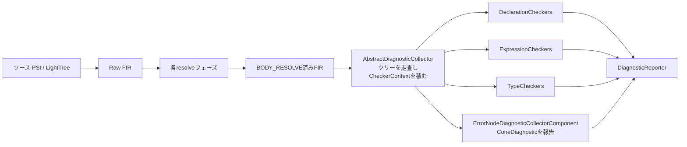

# FIR Checker

K2コンパイラのフロントエンド（FIR: Frontend Intermediate Representation）で、型チェックや宣言の妥当性検査を行い、エラー・警告（diagnostic）を報告する仕組み。名前解決・型推論が全部終わって `BODY_RESOLVE` フェーズまで到達したFIRツリーに対して後から走る。プラグインから独自のCheckerを足す方法は [[fir-additional-checkers-extension]] に分けた。

## 解決（resolve）とチェックの分離

FIRの解決処理は「副作用なし」が原則で、解決済みのFIRツリーを作るだけで、その最中にdiagnosticを直接報告しない。

- 解決中にしか分からない問題（型不一致などの推論エラー、オーバーロード曖昧、不可視参照、supertypeの循環など）は、`FirResolvedErrorReference` のような名前に`Error`を含むFIRノードに `ConeDiagnostic` として埋め込まれる
- 後段の `ErrorNodeDiagnosticCollectorComponent` がツリー中の `ConeDiagnostic` を拾って実際のdiagnosticとして報告する
- それ以外の「解決は成功したが言語ルール上ダメ」な検査は、全部Checkerとして独立に書かれる

## 処理の流れ



1. 初期化時に、必要なCheckerのコンテナ群がセッションコンポーネント `CheckersComponent` に集められる
2. チェックフェーズで `AbstractDiagnosticCollector`（の実装）がFIRツリー全体を走査し、走査しながら `CheckerContext` を組み立てる
3. 各要素について、その要素の型に合うCheckerだけを実行する

## Checkerの種類

| 種類 | 対象 |
| --- | --- |
| `FirDeclarationChecker<D>` | 宣言（クラス、関数、プロパティ、ファイル…） |
| `FirExpressionChecker<E>` | 式（関数呼び出し、when、代入…） |
| `FirTypeChecker` | 型参照 |
| `FirLanguageVersionSettingsChecker` | 個別コードによらない言語バージョン設定の検査 |
| `FirControlFlowChecker` | 制御フローグラフ（CFG）を持つ宣言に対するCFA |

宣言・式・型の3種は型パラメータで対象を絞れる。`FirRegularClassChecker`・`FirNamedFunctionChecker`・`FirFunctionCallChecker` のような型エイリアスが自動生成されている。

Checkerは `DeclarationCheckers` / `ExpressionCheckers` / `TypeCheckers` というコンテナに、要素型ごとの `Set` として登録される（`regularClassCheckers`、`namedFunctionCheckers`、`functionCallCheckers`、`whenExpressionCheckers` など）。コンテナ側は「`namedFunctionCheckers` + `functionCheckers` + `callableDeclarationCheckers` + `basicDeclarationCheckers`」のように、より一般的な型のCheckerも合成して実行する。

### コンテナのグループ

- **Common**: 全プラットフォームで常に走る（`CommonDeclarationCheckers` など）
- **プラットフォーム別**: JVM / JS / Native（`JvmDeclarationCheckers` など）
- **Extra**: 既定で無効、`-Wextra` で有効化。重めで通常のコンパイルに必須ではないもの
- **プラグイン由来**: [[fir-additional-checkers-extension]] で追加されたもの

## Checkerのシグネチャ

```kotlin
abstract class FirDeclarationChecker<D : FirDeclaration>(
    final override val mppKind: MppCheckerKind
) : FirCheckerWithMppKind {
    context(context: CheckerContext, reporter: DiagnosticReporter)
    abstract fun check(declaration: D)
}
```

`CheckerContext` と `DiagnosticReporter` は context parameter で受け取る。Kotlin 2.1.20までは `check(declaration, context, reporter)` と普通の引数だった。2.2.0で context parameter 版になり、2.2.20では context parameter 版だけが残っている。

## Checkerの契約

公式の `compiler/fir/checkers/module.md` に書かれているルール:

1. **ステートレス**: 普通は状態を持たない `object` として書く
2. **独立**: 他の全Checkerを無効にしても正しく動く
3. **できるだけ具体的に**: 名前付き関数だけ見たいなら `FirDeclaration` で受けて `is` 判定するのではなく、`FirNamedFunctionChecker` にする。型付きCheckerは合う型の要素でしか呼ばれないので速い
4. **サブツリーを自前で走査しない**: クラスの`init`ブロックを見たいなら、`FirClassChecker` で中を回すより `FirAnonymousInitializerChecker` を書く。理由は2つ:
   - `@Suppress` の処理はディスパッチャ側でやっているので、子要素に報告すると、その間にある `@Suppress` が効かず誤検知になる
   - スコープが小さいほど、IDEで解決が必要な要素が減る
5. **構文に依存しない**: FIRはPSIとLightTreeの両方の構文木で動く。報告位置は `SourceElementPositioningStrategies` で調整する（例: クラス全体のsourceを渡しつつ、表示はクラス名の上にする）。例外は `FirSyntaxChecker` の派生だけ

## CheckerContext

読み取り専用。主な中身:

- `session` / `scopeSession`
- `containingDeclarations`: 外側の宣言シンボルのスタック
- 暗黙レシーバのスタック、解析中のボディの情報（インライン関数のボディ内か、lambda内か等）
- `@Suppress` された diagnostic の情報
- `languageVersionSettings`、`containingFile`
- `findClosest<T>()` で一番近い外側の宣言を取れる

## チェック段階でのFIRの前提（IDEとの関係）

- CLIではプロジェクト全体を `BODY_RESOLVE` まで解決してからCheckerを走らせる
- IDE（Analysis API）は遅延解決なので、他ファイルの宣言がどのフェーズまで解決済みかは分からない
- 保証されるのは **「Checkerに直接渡された要素は `BODY_RESOLVE` 済み」** ということだけ
- そのため `FirBasedSymbol<*>.fir` でシンボルからFIR要素を取り出すのは禁止。シンボルのメンバのアクセサ（必要最小限のフェーズまで遅延解決してから値を返す）を使う

## MppCheckerKind（Common / Platform）

KMPでは、`expect` を含む型が、どのセッションから見るかで別のクラスに解決されうる。

```kotlin
// MODULE: common
expect interface A
class B : A

// MODULE: platform()()(common)
actual interface A {
    fun foo()
}
```

commonから見ると `B` に問題はない。だが `actual A` に解決すると抽象メンバ `foo()` が入ってくるので、`B` は実装漏れになる。そこでCheckerごとにどのセッションで走るかを決める。

- `MppCheckerKind.Common`: 宣言が属するセッションで走る
- `MppCheckerKind.Platform`: KMPコンパイルでは、全モジュールのソースに対して末端のプラットフォームモジュールのセッションで走る

目安として、型・スコープ・プロバイダから得たクラスのスコープを気にしないなら `Common`。型のスコープを見るなら、actual化でスコープが変わる影響をよく考える。`expect` 宣言自体を誤検知しないよう、Platform Checker（expect以外）とCommon Checker（expect専用）に分ける手法もある（例: `FirImplementationMismatchChecker`）。

## Diagnostic

- コンパイラ本体のdiagnosticは `FirErrors` / `FirJvmErrors` / `FirJsErrors` / `FirNativeErrors` に定義されている。IDE（Analysis API）側でdiagnosticごとにクラスを作る必要があるので、これらはジェネレータで自動生成される
- メッセージ文言は `FirErrorsDefaultMessages` などに手で書く
- 報告には `KtDiagnosticReportHelpers` の `reporter.reportOn(source, FACTORY, args...)` を使う。sourceがnullのときの取りこぼしなどの定型処理をまとめてくれる

## バージョンについて

本ノートの内容は Kotlin 2.4.21（2026-10-08リリース）時点の `JetBrains/kotlin` リポジトリのソースと `compiler/fir/checkers/module.md` を前提にしている。Checker APIは安定APIではなく、リリースごとに変わる。例えば `FirSimpleFunction` は2.4系では `FirNamedFunction` に改名されている（2.3.0にはまだ `simpleFunctionCheckers` しかない）。

## 出典

- [compiler/fir/checkers/module.md - JetBrains/kotlin](https://github.com/JetBrains/kotlin/blob/master/compiler/fir/checkers/module.md)
- [FirDeclarationChecker.kt - JetBrains/kotlin](https://github.com/JetBrains/kotlin/blob/master/compiler/fir/checkers/checkers.api/src/org/jetbrains/kotlin/fir/analysis/checkers/declaration/FirDeclarationChecker.kt)
- [MppCheckerKind.kt - JetBrains/kotlin](https://github.com/JetBrains/kotlin/blob/master/compiler/fir/checkers/checkers.api/src/org/jetbrains/kotlin/fir/analysis/checkers/MppCheckerKind.kt)
- [CheckerContext.kt - JetBrains/kotlin](https://github.com/JetBrains/kotlin/blob/master/compiler/fir/checkers/checkers.api/src/org/jetbrains/kotlin/fir/analysis/checkers/context/CheckerContext.kt)
- [Kotlin 2.4.21 release - GitHub](https://github.com/JetBrains/kotlin/releases/tag/v2.4.21)

#kotlin #compiler #k2 #fir
