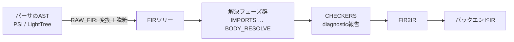

# FIR

FIR（Frontend Intermediate Representation）は、K2コンパイラの新しいフロントエンドと、その中心にあるツリー構造の名前。旧フロントエンド（FE1.0、K1）とは別物として作り直されている。狙いとして公式に挙げられているのは3点。

- 大幅な性能向上
- フロントエンドの各部分の契約（どの時点で何が分かっているか）を明確にする
- コードの意味をよりよく表すデータ構造にする

FIRツリーには、コンパイラがそのコードについて知っている情報がすべて入る。コンパイラはこのツリーを複数のフェーズで少しずつ解決していく。最後に [[fir-checker]] がdiagnosticを報告し、FIR2IRでバックエンドIRに変換される。

## 全体の流れ



## 解決フェーズ（`FirResolvePhase`）

`FirResolvePhase` に定義された順番でフェーズが進む。

| フェーズ | やること |
| --- | --- |
| `RAW_FIR` | パーサのAST（PSIまたはLightTree）からFIRツリーへ変換する。このとき脱糖もする（`if`→`when`、`for`→`iterator`変数＋`while`ループのブロック等） |
| `IMPORTS` | importを解決する。`import aaa.bbb.ccc.D` なら、存在する一番長いパッケージ部分とクラス修飾子の組に分ける |
| `COMPILER_REQUIRED_ANNOTATIONS` | `TYPES` より前に必要な特定のアノテーション（`@SinceKotlin`、`@JvmRecord`、プラグイン用のもの等）の型を解決する。`@Deprecated`・`@Target` などは引数まで解決する |
| `COMPANION_GENERATION` | コンパイラプラグインが提供するcompanion objectを生成する |
| `SUPER_TYPES` | クラスのsupertypeを解決し、typealiasを展開する。型階層のループがあれば断ち切る |
| `SEALED_CLASS_INHERITORS` | sealed classの継承クラスを集めて記録する |
| `TYPES` | 宣言ヘッダに明示的に書かれた残りの型を解決する（戻り値型、引数型、レシーバ型、型パラメータの上限など） |
| `STATUS` | メンバのmodality・可視性・修飾子を決める（overrideしていれば親に依存する） |
| `EXPECT_ACTUAL_MATCHING` | `actual` 宣言ごとに対応する `expect` を対応付けて記録する（[[kotlin-expect-actual]]） |
| `CONTRACTS` | 関数・コンストラクタ・プロパティアクセサのcontract定義を解決する |
| `IMPLICIT_TYPES_BODY_RESOLVE` | 戻り値型を省略した宣言（`fun foo() = 0`、`val bar = "str"`）の型を、本体を解決して決める。constプロパティの初期化子もここで解決する |
| `CONSTANT_EVALUATION` | constプロパティの初期化式などを評価する |
| `ANNOTATION_ARGUMENTS` | 宣言ヘッダにあるアノテーションの引数を解決する |
| `BODY_RESOLVE` | 関数本体、初期化子、デリゲート、引数のデフォルト値などを解決する。制御フローグラフ（CFG）もここで作る |

`fir-basics.md` では、この後に `CHECKERS`（diagnosticを報告してよいのはここだけ）と `FIR2IR` が続くと説明されている。`COMPILER_REQUIRED_ANNOTATIONS`〜`ANNOTATION_ARGUMENTS` はローカルでない宣言に対して走る。ローカルクラスや匿名オブジェクトは、`BODY_RESOLVE` 中に見つかった時点で、それ単体に対してこれらのフェーズが走る。

### フェーズの契約

1. フェーズは必ず順番に実行する。あるフェーズまで解決したいなら、手前のフェーズをすべて先に済ませる
2. より後のフェーズの情報を要求したり、当てにしたりしてはいけない。例えば `STATUS` 中は暗黙の型がまだ分からない（決まるのは `IMPLICIT_TYPES_BODY_RESOLVE`）
3. 他の宣言の「今のフェーズの情報」を要求してよいのは、jumping phase の中だけ

この結果、「フェーズBがAの後なら、Bから見えるFIR要素はすべてAまで解決済み」という不変条件が成り立つ。

### jumping phase

同じフェーズの中で、他の宣言をそのフェーズまで解決しに行ける（ジャンプできる）フェーズ。

- `COMPILER_REQUIRED_ANNOTATIONS`: アノテーションの使用箇所からアノテーションクラスへ飛び、その注釈も解決する
- `SUPER_TYPES`: 一番下のクラスから上へ、supertypeを再帰的に解決する
- `STATUS`: 親の宣言のstatusを先に解決する
- `IMPLICIT_TYPES_BODY_RESOLVE`: 暗黙の型が別の宣言の暗黙の型に依存するとき、そちらを先に計算する

## CLIモードとAnalysis APIモード

```kotlin
// CLI（フル解決）: フェーズごとに全ファイルを処理する
for (phase in allFirResolvePhases) {
  for (file in allFirFiles) {
    runPhaseOnFile(file, phase)
  }
}

// Analysis API（遅延解決）: 要求された宣言だけを必要なフェーズまで進める
for (phase in allFirResolvePhases) {
  runPhaseOnDeclaration(declaration, phase)
}
```

IDE（K2モード）、[[ksp]]（KSP2）、Android Lint が使う Analysis API は後者のモードで動く。そのため、どの宣言がどのフェーズまで解決済みかが場所によってバラバラになる。

## FIR要素

すべてのノードは `FirElement` を継承する。大きく3種類ある。

- **`FirDeclaration`**: 宣言。宣言ごとにユニークな**シンボル**を持つ。参照はシンボル経由なので、宣言を作り直しても参照は壊れない
- **`FirExpression`**: 式。式の型を持つ
- **`FirTypeRef`**: コード上の型参照。型そのもの（`ConeKotlinType`。K1の `KotlinType` に相当）とは区別されている
  - `FirUserTypeRef`: ソースに書かれたが未解決の型参照
  - `FirImplicitTypeRef`: 書かれていない型（`val x = 1`）
  - `FirResolvedTypeRef`: 解決済みで、中に `ConeKotlinType` を持つ

プラグインから見えるノード型は全部abstractで、実装クラスは隠されている。ノードを作るときはノードごとに用意されたビルダー関数を使う。

```kotlin
val myFunction = buildNamedFunction {
    name = Name.identifier("myFunction")
    ...
}
```

## 宣言の探し方: SymbolProviderとScope

- **`FirSymbolProvider`**: クラスを `ClassId` で、トップレベル関数・プロパティを `CallableId` で引く。実体は複数のproviderの合成で、現在のモジュールのソース、プラグインが生成した宣言、依存するソースモジュール（Analysis API時）、バイナリ依存を順に探す。同じ `ClassId` のクラスは1つしかないという契約があるので、クラスは最初に見つかった時点で返す
- **`FirScope`**: import、クラスメンバなど、特定の範囲から宣言を探す

どちらも返すのは宣言そのものではなくシンボル。中身はシンボルのアクセサから取る。遅延解決のモードで、アクセサが必要なフェーズまで解決を起こすため。

```kotlin
val functionSymbol: FirNamedFunctionSymbol = ...
val returnType: FirResolvedTypeRef = functionSymbol.resolvedReturnTypeRef
// NG: functionSymbol.fir.returnTypeRef as FirResolvedTypeRef
```

ただしアクセサを使っても、今いるフェーズで解決済みと保証される情報しか触ってはいけない（例: `STATUS` 中に解決済みの戻り値型を取るのは不正）。

## バージョンについて

本ノートの内容は Kotlin 2.4.21（2026-10-08リリース）の `JetBrains/kotlin` リポジトリにある `FirResolvePhase.kt` と `docs/fir/fir-basics.md` を前提にしている。フェーズの構成は内部実装なので、バージョンによって増減しうる。

## 出典

- [docs/fir/fir-basics.md - JetBrains/kotlin](https://github.com/JetBrains/kotlin/blob/master/docs/fir/fir-basics.md)
- [FirResolvePhase.kt - JetBrains/kotlin](https://github.com/JetBrains/kotlin/blob/master/compiler/fir/tree/src/org/jetbrains/kotlin/fir/declarations/FirResolvePhase.kt)
- [Kotlin 2.4.21 release - GitHub](https://github.com/JetBrains/kotlin/releases/tag/v2.4.21)

#kotlin #compiler #k2 #fir
