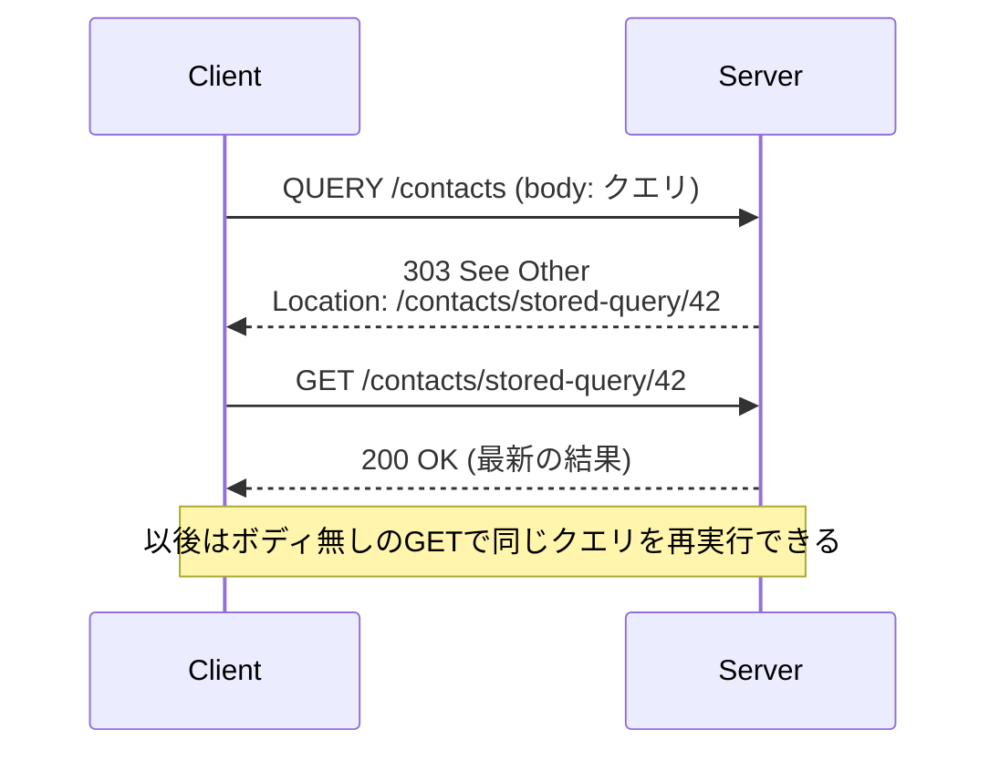

# HTTP QUERYメソッド

リクエストボディを持てるのに、GETと同じく**safe（安全）かつidempotent（冪等）**なHTTPメソッド。RFC 10008「The HTTP QUERY Method」として2026年6月にProposed Standardで発行された（発行日は6/15とする記事と6/19とする記事がある）。新しい標準メソッドが入るのはPATCH（RFC 5789、2010年）以来。IANAのメソッドレジストリにもsafe/idempotentとして登録されている。

## なぜ用意されたか

「検索条件が複雑な読み取り」を素直に表現するメソッドがなかった。

- **GET**: safe/idempotentでキャッシュもリトライもできるが、ボディの意味が定義されていない。なので条件は全部URIのクエリ文字列に詰めるしかない
  - 複雑なフィルタ・JSONクエリ・SQL/GraphQL的なクエリはURIの実用上の長さ制限を超えやすい（サーバー・プロキシ側の制限、414 URI Too Long）
  - URIに入れた値はアクセスログ・ブラウザ履歴・プロキシ・監視系に残りやすく、機微な値を載せにくい
  - クエリ文字列へのエンコード自体が面倒（ネスト構造など）
  - 「GETにボディを付ける」はRFC 9110上意味が定義されておらず、中間装置やライブラリによって捨てられたり拒否されたりする
- **POST**: ボディは持てるがsafeでもidempotentでもない。キャッシュや中間装置が「同じリクエストを繰り返しても大丈夫」と判断できず、自動リトライやキャッシュが効かない。`POST /search` で読み取りを表現するのは慣習として広く使われてきたが、意味的には嘘になる

QUERYは「ボディで条件を送る」と「GET相当の安全性・冪等性」を両立させる。

| | GET | QUERY | POST |
| --- | --- | --- | --- |
| safe | ○ | ○ | × |
| idempotent | ○ | ○ | × |
| ボディの意味 | 定義なし | ターゲットリソースが定義 | ターゲットリソースが定義 |
| キャッシュ | ○ | ○（キーにボディを含める） | 基本× |
| HTMLフォームから送信 | ○ | × | ○ |

## 経緯

- 元はWebDAV系のSEARCHメソッド（RFC 5323）。個人ドラフト `draft-snell-search-method` が2015〜2020年に改訂され、2021年3月にhttpbis WGドラフト `draft-ietf-httpbis-safe-method-w-body-00`（タイトルはまだ「HTTP SEARCH Method」）に引き継がれた
- -03版の時点で「The HTTP QUERY Method」に改名されている（ドラフト著者: J. Reschke, A. Malhotra, J. Snell）
- 2026年6月にRFC 10008として発行

## 仕様の要点

### 基本

- QUERYはターゲットリソースに対して「リクエストボディの内容をsafe/idempotentな方法で処理し、結果をレスポンスで返せ」と依頼するメソッド
- クエリ言語は規定しない。ボディの解釈は `Content-Type` で示したメディアタイプとリソース側の取り決め次第（JSON、JSONPath、SQLなど何でもよい）
- メディアタイプ情報がない／矛盾するQUERYリクエストは400や415で拒否する（Envoyも「Content-TypeのないQUERYは全プロトコルで拒否」と実装している）

例（イメージ）:

```http
QUERY /contacts HTTP/1.1
Host: example.org
Content-Type: application/sql
Accept: text/csv

select surname, givenname, email limit 10
```

### Accept-Query レスポンスヘッダ

- リソースがQUERYに対応していること、受け付けるクエリのメディアタイプを広告する新しいヘッダ
- Structured FieldsのList。各要素はToken か String（どちらで書いても意味は同じ）。順序に意味はない
- RFC中の例: `Accept-Query: "application/jsonpath", application/sql;charset="UTF-8"`
- 他に `OPTIONS` + `Allow` で対応確認したり、送ってみて405/415をハンドリングしたりもできる

### Location / Content-Location

QUERYの結果をGETで再取得できるURIをサーバーが返せる。

- **Content-Location**: 「今回の実行結果」を表すリソース。一時的なものでもよい。GETするとその時点の結果のスナップショットが取れる
- **Location**: 「このクエリそのもの」と等価なリソース（equivalent resource）。GETすると同じクエリを再実行した最新結果が返る。以降はボディを再送せずGETで済ませられる
- **303 See Other** + `Location`: 「結果はこっちをGETして取れ」と誘導する、もっとも強い形



### リダイレクト

- 301/302/307/308はいずれも「新しいURIに同じQUERYを送り直してよい」という意味になる
- POSTで歴史的に許されてきた「301/302でGETに書き換える」例外はQUERYには適用されない
- 303だけはGETへの切り替え（上記）

### キャッシュ

- レスポンスはキャッシュ可能。ただしキャッシュキーにはURIだけでなく**リクエストボディと関連メタデータ（Content-Type等）を含めなければならない**
- ドラフト段階の記述では、キャッシュは意味的に差のない違い（例: JSONの空白・キー順など）をキー計算前に正規化してよい（SHOULD）とされていた
- 条件付きヘッダ（`If-Match`/`If-None-Match` 等）を付けると条件付きQUERYになる

### ブラウザ / CORS

- QUERYはCORS-safelistedメソッドではないので、クロスオリジンの `fetch(url, {method: "QUERY"})` は必ずpreflightが飛ぶ。サーバーは `Access-Control-Allow-Methods` にQUERYを含める必要がある
- HTMLフォームからは送れない
- MDNは「ブラウザ側にQUERY固有の統合はない」としている。fetchで任意メソッドとして送ることはできる

## 実際に使うときの懸念点（2026年11月時点の対応状況）

一番の問題はRFCそのものではなく、**リクエスト経路上の全部品（CDN・LB・WAF・リバースプロキシ・APIゲートウェイ・フレームワーク）がQUERYを知っている必要がある**こと。どれか1つが知らないと400/405で落ちるか、POST扱い・キャッシュ不可になる。調査時点ではブログ・トラッカー由来の情報が多く、ベンダー公式の表明は少ない。

### サーバー・言語ランタイム

- **Node.js**: llhttp 9.2.0でQUERYを認識するようになり、Node.js 21.7.2から対応（`http.METHODS` に含まれる）。Node 20系にも20.19.2のセキュリティリリースでllhttp 9.2.0が入った。それ以前は400 Bad Request
- **Go net/http**: 任意のメソッド文字列を扱えるので送受信自体はできる
- **ASP.NET Core**: `HttpMethods.Query` 定数がある。`MapQuery` や `[HttpQuery]` 属性が出荷されたかは未確認で、`MapMethods(..., [HttpMethods.Query], ...)` で受けるのが確実。.NET 11 Preview 4でOpenAPI生成がQUERYを認識するようになった
- **Spring Framework**: 7.0.xにはネイティブ対応なし（`RequestMethod.QUERY` で書けない）。7.1をターゲットに作業中とされるが、出荷は未確認
- **Rails**: `ActionDispatch::Request` のメソッド許可リストにないため、コントローラに届く前に405になる。対応は提案・PR段階
- **Envoy**: v1.40.0で「HTTP/1がRFC 10008のQUERYを受け付ける（revertible）、Content-TypeのないQUERYは拒否」。それ以前はHTTP/1.1のQUERYが400になっていた
- **Gateway API（kgateway等）**: `HTTPMethod` が閉じたenumなので、ルートのメソッドマッチにQUERYを書けない

### リバースプロキシ

- **nginx**: QUERYを透過的にプロキシはするが、キャッシュはしない。`limit_except GET POST HEAD QUERY { ... }` と書くと1.31.5では `invalid method "QUERY"` で設定テストが失敗する。基本サポートのコミットは入っているがリリース済みかは情報が食い違っている
- **Caddy / Traefik**: 未知メソッドとしてそのまま通す（キャッシュ等の特別扱いはしない）

### CDN

- **Cloudflare**: RFC著者の所属企業の一つだが、エッジキャッシュがQUERYをボディ込みでキャッシュするという公式発表は見つからなかった。[[cloudflare-workers]]のCache API（workerd）でQUERYをボディキーでキャッシュする対応はissue段階
- **CloudFront**: 許可メソッドが固定セットなのでQUERYは通らないとされる。Lambda@EdgeでQUERY→GET+ボディハッシュに書き換える回避策が紹介されている
- **Akamai / Fastly**: ネイティブ対応の情報なし。メソッド許可リストの変更やEdgeWorkers・VCL（`req.hash += req.body`）でキャッシュキーを拡張する回避策が紹介されている
- 全体として「大規模に信頼できるQUERYキャッシュはまだない」（SANS ISC）

### クライアント・ツール

- **curl**: `curl -X QUERY -H 'Content-Type: application/json' --data '...'` で普通に送れる
- **OpenAPI 3.2.0**: Path Itemに `query` フィールドが追加され、QUERYオペレーションを記述できる。3.1以前では拡張で書くしかない

### セキュリティ面

- **WAF/検査のすり抜け**: POSTなら検査・ブロックされるペイロードが、ルールがQUERYを想定していないために素通りする可能性
- **キャッシュポイズニング/デセプション**: ボディをキーに入れない（または正規化が甘い）キャッシュが、別のクエリの結果を返してしまう
- **CSRFミドルウェア**: safeメソッド扱いで検査をスキップするミドルウェアがある。QUERYハンドラ側で副作用を起こさない実装になっていることが前提
- **ボディ処理の不一致**: CDNとオリジンでボディの扱いが食い違うとリクエストスマグリング的な問題につながりうる（指摘はされているが具体的な事例は未確認）

### まとめると

- サーバー間・社内API（経路を自分で全部把握できる）なら今すぐ使える
- ブラウザ向け公開APIは、preflight対応とCDN・WAFの対応確認が必要。キャッシュ目的で入れても現状ほぼ効かない
- 当面は `POST /search` も受けるか、303 + Location でGETに逃がす設計が無難

## 出典

- [RFC 10008: The HTTP QUERY Method](https://www.rfc-editor.org/rfc/rfc10008.html)（ネットワーク制限で本文は直接取得できず、検索結果の抜粋で確認）
- [RFC 10008 info page](https://www.rfc-editor.org/info/rfc10008/)
- [draft-ietf-httpbis-safe-method-w-body-06](https://conference.greenbytes.de/tech/specs/draft-ietf-httpbis-safe-method-w-body-06.html)（キャッシュキー正規化の記述）
- [draft-ietf-httpbis-safe-method-w-body-00](https://datatracker.ietf.org/doc/draft-ietf-httpbis-safe-method-w-body/00/)
- [draft-snell-search-method](https://datatracker.ietf.org/doc/draft-snell-search-method/history/)
- [QUERY request method - MDN](https://developer.mozilla.org/en-US/docs/Web/HTTP/Reference/Methods/QUERY)
- [QUERY - http.dev](https://http.dev/query)
- [IETF Publishes RFC 10008 - InfoQ](https://www.infoq.com/news/2026/09/http-query-method/)
- [IETF publishes QUERY method - InfoWorld](https://www.infoworld.com/article/4196909/ietf-publishes-query-method-to-allow-safe-and-idempotent-http-requests.html)
- [OpenAPI 3.2 query example](https://learn.openapis.org/examples/v3.2/3.2-query-example.html)
- [ietf-http-wg ML / ietf-http-wg（llhttp 9.2.0とNode.js 21.7.2）](https://lists.w3.org/Archives/Public/ietf-http-wg/2025AprJun/0154.html)
- [expressjs/express#5615](https://github.com/expressjs/express/issues/5615)
- [envoyproxy/envoy#46404](https://github.com/envoyproxy/envoy/issues/46404)
- [kgateway-dev/kgateway#14853](https://github.com/kgateway-dev/kgateway/issues/14853)
- [cloudflare/workerd#6849](https://github.com/cloudflare/workerd/issues/6849)
- [spring-projects/spring-framework#34993](https://github.com/spring-projects/spring-framework/pull/34993)
- [dotnet/aspnetcore#65714](https://github.com/dotnet/aspnetcore/pull/65714)
- [ASP.NET Core 11 HTTP QUERY / OpenAPI - Start Debugging](https://startdebugging.net/2026/05/aspnetcore-11-http-query-method-openapi/)
- [Proposal: Support for the HTTP QUERY method - Rails Discussions](https://discuss.rubyonrails.org/t/proposal-support-for-the-http-query-method-rfc-10008/91255)
- [nginx will proxy the new HTTP QUERY method. It will never cache one. - DEV](https://dev.to/remdore/nginx-will-proxy-the-new-http-query-method-it-will-never-cache-one-3f8i)
- [nginx limit_except and QUERY - DEV](https://dev.to/alexgeorgiev17/nginxs-limitexcept-block-silently-rejects-the-new-http-query-method-1gcg)
- [HTTP QUERY Method: The Grey Zone Between GET And POST - SANS ISC](https://isc.sans.edu/diary/33352)
- [RFC10008support（エコシステム対応トラッカー）](https://github.com/ebremer/RFC10008support)
- [Akamai and Cloudflare Wrote HTTP's Newest Method. Your Edge Stack Doesn't Know It Yet.](https://www.shashi.co/2026/08/akamai-and-cloudflare-wrote-https.html)
- [RFC 10008 attack surface - Hive Security](https://hivesecurity.gitlab.io/blog/http-query-method-rfc-10008-attack-surface/)
- [A Method for the Madness: Meet HTTP QUERY - F5 DevCentral](https://community.f5.com/t/a-method-for-the-madness-meet-http-query/77265)

#http #web #api-design #ietf #rfc
