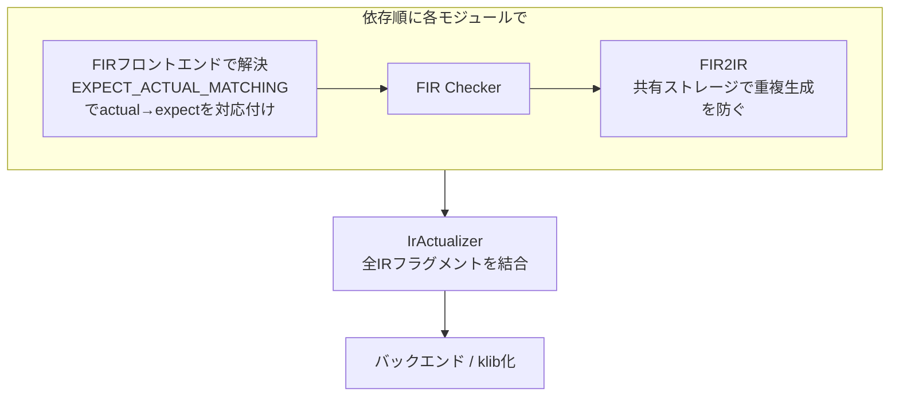

# expect/actual

Kotlin Multiplatform（KMP）で、共通コード（common source set）に「宣言だけ」を置き、実装をプラットフォームごとのsource setに書き分ける仕組み。commonに `expect` を書き、各プラットフォームに同じパッケージ・同じシグネチャの `actual` を書く。

```kotlin
// commonMain
expect fun buildIdentity(): Identity

// jvmMain
actual fun buildIdentity() = Identity(...)
```

## 言語としてのルール

- `expect` にできるのは関数・プロパティ・クラス・interface・enum・annotation（`expect object` も可）。`expect` 宣言は実装を持たない
- commonの `expect` には、各プラットフォームで対応する `actual` が必要。`actual` は `iosMain` のような中間source setに置いてもよい
- `actual` は `expect` と同じパッケージに置く
- **expect/actual クラスはBeta**。使うと警告が出るので、黙らせるには `-Xexpect-actual-classes` を付ける
  ```kotlin
  kotlin {
      compilerOptions {
          freeCompilerArgs.add("-Xexpect-actual-classes")
      }
  }
  ```
- **typealiasでactual化**できる。既存のプラットフォーム型をそのまま当てられる
  ```kotlin
  actual typealias Month = java.time.Month
  actual typealias MyDate = java.time.LocalDate
  ```
  当てる型は `expect` 側の要件をすべて満たす必要がある（`LocalDate` が `Month` を使うなら、`Month` も `expect` しておく）
- **actual enum** は `expect` と同じエントリを持つ必要があり、追加のエントリも持てる。追加分はcommonから見えないので、`when` には `else` が必要になる
- **`@OptionalExpectation`**（`@OptIn(ExperimentalMultiplatform::class)` が必要）を付けたexpect annotationは、使われないプラットフォームでは `actual` を省略してよい

公式の推奨は「できるだけ通常の言語機能を使い、expect/actualに頼らない」。特に `expect class` より interface を勧めている。interfaceならプラットフォームごとに実装を1つに縛られず、テストでfakeに差し替えたり、同じプラットフォームで複数の実装を持ったりしやすい。DIを使うなら、expect/actualが要るのはDIの設定部分だけになる。

## コンパイラ内部（K2）での扱い

### 2種類のコンパイル

- **メタデータコンパイル**: commonなsource setを1つずつ、メタデータklibの依存だけでコンパイルする。actual化から切り離して解析し、複数ターゲットでコンパイルできることを確かめる。出力のメタデータklibは、IDEと他のメタデータコンパイルが使う。中間source setに `actual` がありうるので、actual→expect の対応付けとチェックもする
- **プラットフォームコンパイル**: ターゲットごとに1回走る。そのターゲットのdepends-onグラフにある全source setを入力にし、jarやklibを出力する。source setごとにコンパイラの「モジュール」（= 1つの `FirSession`）ができる

### プラットフォームコンパイルの流れ



1. モジュールをdepends-on関係でトポロジカルソートし、最も共通なものからプラットフォームへ順に解析する。依存先モジュールのFIRを、後続モジュールの依存としてそのまま使う
2. 各モジュールで、フロントエンド → [[fir-checker]] → FIR2IR を走らせる
3. `IrActualizer` で全IRフラグメントをまとめて actual化する
4. 結果のIRをバックエンドに渡すか、klibにシリアライズする

### フロントエンド側: actual→expect の対応付けと型の精製

- [[fir]] の解決フェーズ `EXPECT_ACTUAL_MATCHING` で、`actual` ごとに対応する `expect` を対応付ける。クラスは `ClassId` が同じなら対応、callableはオーバーロード解決に似た複雑なルールで対応する。フロントエンドの時点では全部の `actual` が揃っていないので、作れるのは actual→expect 方向だけ
- **型の精製（type refinement）**: commonで `val foo: Foo`（`expect class Foo`）と宣言しても、プラットフォームモジュールから `foo.bar()` を呼ぶときは `actual class Foo` として見えないといけない。そこで、型のスコープや宣言クラスは常に「使う側のセッション（use-site session）」を指定して引く
  1. `fullyExpandedType(useSiteSession)` で、使う側から見たtypealiasを展開する
  2. `lookupTag.toSymbol(useSiteSession)` で、使う側のモジュールで `ClassId` からクラスを引き直す

  [[fir-checker]] に `MppCheckerKind`（Common / Platform）があるのは、同じ型でもセッションによって解決先が変わるため

### バックエンド側: IrActualizer

IRだけを入出力にして（FIRにはアクセスしない）、`expect` の残ったIRを、普通の非マルチプラットフォームと同じ状態のIRに変える。処理順は次のとおりで、これには依存関係がある。

1. クラスの expect→actual を対応付けて適用する
2. fake override を組み立てる（本当のsupertypeが決まってからでないと作れない）
3. callableの expect→actual を対応付けて適用する（fake overrideと対応しうるので2の後）。この時点で全部の `expect` が揃っているので、この方向の対応が作れ、diagnosticも出せる
4. デフォルト引数のIRを `expect` から `actual` へコピーする
5. フラグメントを1つに結合し、fake overrideのシンボルを普通のシンボルに置き換える
6. 定数を評価する（`expect` 関数がactual化されて初めて評価できるものがあるので3の後）
7. トップレベルの `expect` 宣言をIRから外す（`@OptionalExpectation` を除く）

fake overrideをFIR2IRの時点で確定できない例がある。commonで `expect class A`・`expect class B` を引数に持つ `foo` がそれぞれ別interfaceから来るとき、プラットフォームで `actual typealias A = Int`・`actual typealias B = Int` にすると、2つの `foo` が1つに合流する。そのためFIR2IRは特殊なfake overrideシンボルを作っておき、actual化の後に普通のシンボルへ置き換える。

公式ドキュメントでは、この「K2のKMPコンパイルモデル」は暫定で、KT-57327で最終形に変える予定とされている。

## バージョンについて

言語ルールは Kotlin公式ドキュメント（Kotlin Multiplatform）の確認時点（2026-11）の記述に基づく。コンパイラ内部の話は Kotlin 2.4.21（2026-10-08リリース）の `docs/fir/k2_kmp.md` を前提にしている。

## 出典

- [Expected and actual declarations - Kotlin Multiplatform Documentation](https://kotlinlang.org/docs/multiplatform/multiplatform-expect-actual.html)
- [docs/fir/k2_kmp.md - JetBrains/kotlin](https://github.com/JetBrains/kotlin/blob/master/docs/fir/k2_kmp.md)
- [docs/fir/fir-basics.md - JetBrains/kotlin](https://github.com/JetBrains/kotlin/blob/master/docs/fir/fir-basics.md)
- [Kotlin 2.4.21 release - GitHub](https://github.com/JetBrains/kotlin/releases/tag/v2.4.21)

#kotlin #kotlin-multiplatform #compiler #k2
