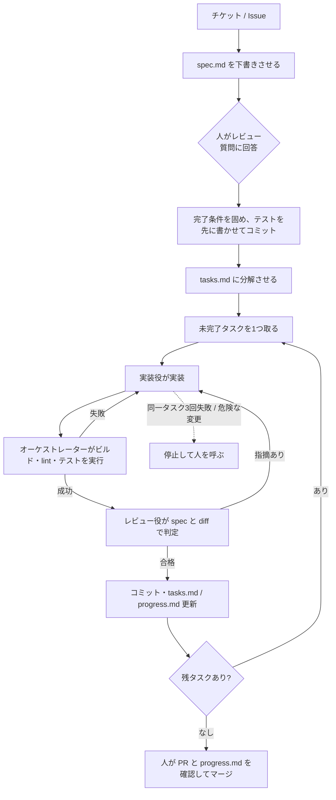

# ループエンジニアリングの実践

[[loop-engineering]]を実際の機能改修に当てはめるときの観点・進め方・プロンプト例。考え方そのものは[[loop-engineering]]、Claude Code上の部品は[[claude-code-loop]]を参照。

ループの本体は「次の一手を出す役割を人からシステムへ移す」こと。ただし人がいなくなるわけではない。ゴールの定義、止め方の設計、例外時の判断は人に残る。Addy Osmaniの言い方では、**作業は委任しても判断は委任しない**。

## 必要な観点

### 1. 完了条件は機械が判定できる形にする

- 「良くなるまで」ではなく、テスト通過やlint通過、閾値（Lighthouseスコアなど）のように決定的で測定可能な条件にする。
- 「テスト通った」という自己申告ではなく、オーケストレーターが実際にコマンドを叩いた結果で判定させる。
- 編集が成功しただけで完了扱いにしない。失敗したら直して最初から検証し直し、部分的な検証で報告させない。
- 自動判定できないもの（UIの見た目や文言）は「人が確認」と明記して、ループの外に出す。

検証の層ごとに並べると抜けが見つけやすい。

| 層 | 例 |
|---|---|
| ビルド・静的検査 | ビルドとlintが通る |
| 単体テスト | 受け入れ条件ごとに対応するテストがある |
| 異常系・境界値 | 不正値でエラーを返す、空や上限の扱い |
| 結合 | 外部ミドルウェアへのクエリやリクエストの中身を確認する |
| 非退行 | 既存テストが全件通る |
| 範囲 | 触ってよい範囲外の差分がない、スキーマ変更なし |
| 人が確認 | 見た目、文言 |

### 2. 停止条件を先に決める

- 反復回数の上限を必ず設ける。
- 同じコマンドを繰り返して結果が変わらないのは空回りの典型的な兆候。3回目で止めるのが目安。
- 改善がないターンが続いたら中止する。
- 危険な変更（スキーマ変更、公開APIの互換性破壊、認証・権限まわり）は、ループ内で進めずに人の承認待ちにする。

### 3. maker-checker（作る役と検証する役を分ける）

- 作業したエージェントに、その成果が良いかを判断させない。
- レビュー役には実装時の会話を渡さず、仕様と差分だけで判定させる。できれば別モデルを使う。
- 完了条件は実装役に決めさせない。合格ラインを自分で決めると通しやすい条件に寄るため、案を出させて人が承認する。

### 4. 状態をファイルに残す

ループが途中で止まったり、別のエージェントに引き継いだりしても再開できるように、状態は会話ではなくファイルに置く。

```
docs/tasks/<slug>/
  spec.md      # 目的・受け入れ条件・完了条件・範囲外・停止条件・未解決の質問
  tasks.md     # 1コミット単位のチェックリスト
  progress.md  # 各周回の結果ログ（ループが書き足す）
```

ファイルは最初から用意されている必要はなく、チケットやIssueからエージェントに下書きさせればよい。すぐ終わる小さな改修なら、ファイルを作らずにゴールと完了条件だけをプロンプトに書く形でも回る。

### 5. 委任と監視の度合いを仕事で変える

- ドキュメント作成やテストの追加のような安全な作業は、丸ごと委任してよい。
- 認証、セキュリティ、金融、外部システムの権限が関わる作業は、コードを精査して監視する。
- グリーンフィールドと、レガシーで履歴の重いブラウンフィールドとでは慎重さの度合いを変える。

### 6. 向かない仕事

- 完了条件が曖昧な作業（「このUIが良くなるまで」）。何をもって良いとし、誰が評価するのかが決まらない。
- 主観的なデザイン判断やオープンエンドな創作。
- 調査や理解が主な作業。ループが効くのは、実装と検証の部分に限られるという指摘もある。

## 進め方（機能改修の例）

例として「検索APIにソート条件を追加する」改修を考える。順番は**仕様 → 完了条件 → テスト固定 → 実装ループ**。人が時間を使うのは最初と最後だけにする。



1. **仕様の下書き**: チケット本文を渡して、spec.mdを書かせる。実装はさせない。不明点は勝手に決めさせず、質問リストにさせる。
2. **人がレビュー**: 質問に答えて、spec.mdを直す。一番時間を使うべきはここ。
3. **完了条件とテストの固定**: 完了条件を受け入れ条件ごとに対応づけ、先にテストだけ書かせて人が確認してコミットする。以降のループでは、既存テストの削除や期待値の変更を禁止する。
4. **タスク分解**: spec.mdを1コミット単位に分けてtasks.mdにさせる。粒度が大きければ分けさせる。
5. **実装ループ**: 1タスクずつ、実装 → 機械的な検証 → レビュー → コミットを回す。人は介入しない。
6. **停止**: 全タスクの完了か停止条件で止まる。止まったエージェントは[[herdr]]上で`blocked`になるので、人はそこだけ見ればよい。
7. **最終確認**: 人がPRの差分とprogress.mdを読んでマージする。この確認を残すのがライトファクトリー的な運用。

並列で回すなら、タスクごとにgit worktreeを分けて衝突を避ける。最初は1〜2タスクで試し、止まった理由を見てspec.mdや停止条件を直す。この改善の繰り返し自体がループエンジニアリングの本体。

## プロンプト例

### spec.mdの下書き

```
この改修内容から docs/tasks/search-sort/spec.md を作って。実装はまだしない。
- 既存コード（Controller / Service / Repository / テスト）を読んで、影響範囲と既存の作法を調べる
- 目的・受け入れ条件・範囲外・停止条件のセクションを作る
- 不明点は勝手に決めず、質問リストにして最後に並べる
- 受け入れ条件は「テストで確認できる形」で書く
```

### 完了条件

```
spec.md に「完了条件」セクションも書いて。
- 受け入れ条件ごとに、どのテストで確認するかを対応させる
- 正常系だけでなく、異常系・境界値・既存機能の非退行も含める
- 自動で判定できない条件（UIの見た目など）は「人が確認」と明記する
- 迷った点は質問リストに入れる
```

### タスク分解

```
spec.md を1コミット単位のタスクに分解して docs/tasks/search-sort/tasks.md に
チェックリストで書いて。各タスクに、完了をどのテストで確認するかを添える。
```

### オーケストレーター（[[herdr]]上で動かす場合）

```
あなたはオーケストレーター。docs/tasks/search-sort/spec.md を読み、
tasks.md の未完了タスクを上から1つずつ処理する。
- 実装は herdr で新しいペインに Claude Code を起動して依頼する
- 完了後、ビルド・lint・テストを自分で実行し、失敗ならログを実装役に返す
- 通ったら別ペインのレビュー役に spec.md と git diff だけを渡して、
  完了条件を1つずつ「満たした/未達」で判定させる
- 合格ならコミットし、tasks.md にチェックを付け、progress.md に判定表を書いて次へ
- 既存テストの削除・期待値の変更は禁止
- 同一タスクで3回失敗、またはスキーマ変更が必要になったら停止して理由を書く
```

ペインの起動や指示には、[[herdr]]のCLI（`herdr pane split`、`herdr agent start`、`herdr agent prompt ... --wait`）を使う。最初に`herdr --skill`でガイドを読ませておくと、操作を間違えにくい。

### ファイルを作らない軽量版

```
目標：検索APIに sort パラメータ（score / date）を追加
完了条件：ビルド・lint・テストが通り、追加したテストで
          両方の並び順と不正値の400を確認できていること
制約：スキーマ変更はしない。3回直して通らなければ止まって報告
```

Claude Codeでは`/goal`がこの形（単一の有限タスクを、完了条件を満たすまで進める）に対応する。

## チームに広めるとき

- spec.mdのテンプレート（目的、受け入れ条件、完了条件、範囲外、停止条件、質問）をリポジトリに置く。
- 「チケットからspec.mdを起こす」「完了条件を判定する」といった手順を、CLAUDE.mdやskillにして誰でも同じ形でループに乗せられるようにする。

## 出典

- [Practical Loop Engineering - by Addy Osmani - Elevate](https://addyo.substack.com/p/practical-loop-engineering)
- [Loop engineering: Getting started with loops | Claude by Anthropic](https://claude.com/blog/getting-started-with-loops)
- [ループエンジニアリングとは?AIエージェントを自律で動かすループ設計の考え方と始め方 - issoh](https://www.issoh.co.jp/tech/details/12610/)
- [ループエンジニアリングとは?takt execで始めるAIエージェント改善ループの設計入門 - issoh](https://www.issoh.co.jp/?p=12936)
- [Software Factories, Light and Dark - Addy Osmani](https://addyosmani.com/blog/software-factories/)
- [herdr - GitHub](https://github.com/ayamir/herdr)

#loop-engineering #ai #agent #claude-code
