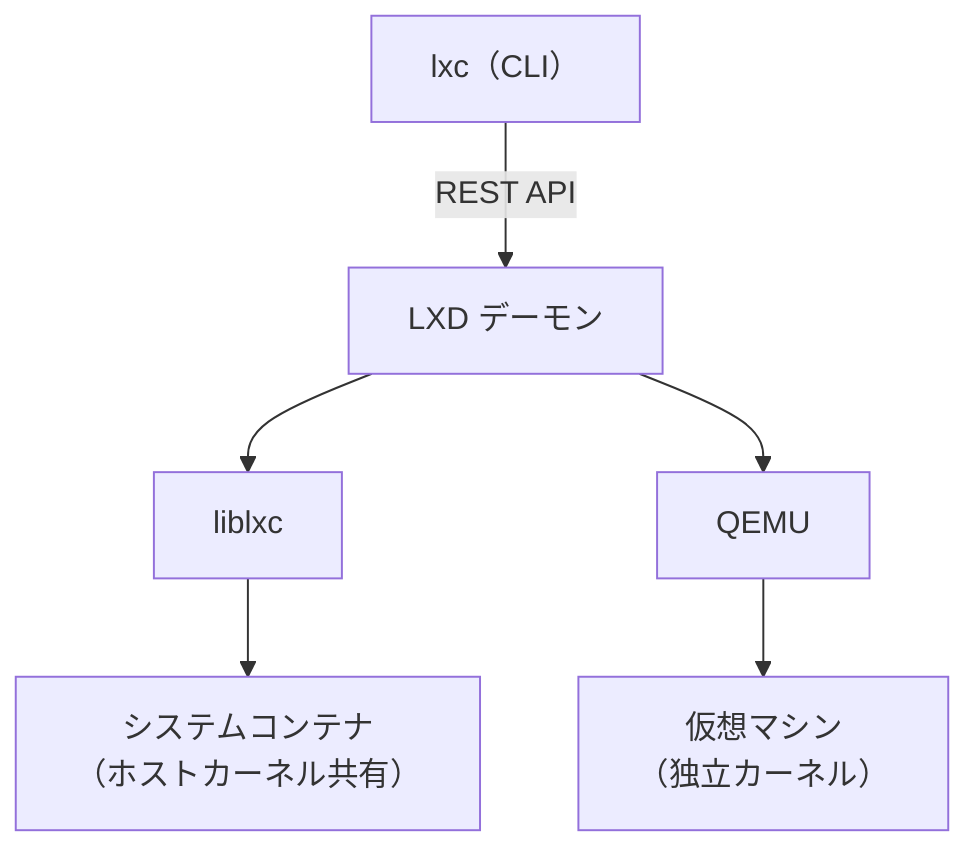

# LXD

Canonicalが開発している、Linux向けのシステムコンテナと仮想マシンの管理ツール。デーモンとして常駐し、REST API経由で操作する。CLIクライアントは `lxc` コマンド（低レベルランタイムのLXCとは別物なので紛らわしい）。主な配布形態はsnap。

## 何を管理するか

LXDが扱う「インスタンス」は2種類ある。

- **システムコンテナ**: OS丸ごとを動かすコンテナ。initから起動し、複数プロセスが動く。ホストとカーネルを共有するので、VMより軽くて起動が速い。実装には liblxc（LXC）を使う。
- **仮想マシン**: 物理マシンをエミュレートし、完全に分離されたOSを動かす。実装にはQEMUを使う。LXD 4.0からネイティブにサポートされている。ホストのカーネルが持たない機能が必要なときや、別のOSを動かしたいときはVMを使う。

Dockerのような**アプリケーションコンテナ**は、1つのプロセス／アプリケーションをパッケージングするためのもの。システムコンテナはOS全体をシミュレートし、ユーザースペースを分けてプロセスを分離できる。ここが両者の違い。

その他の機能: ストレージプール（ZFS、Btrfs、LVMなど）、ネットワーク、プロファイル、スナップショット、クラスタリング。LXD 6.6ではインスタンスのplacement group、KubernetesのCSIドライバー、カスタムストレージボリュームの復旧改善が入った。

## Incusとの関係

2023年、CanonicalがLXDを自社の完全な管理下に戻したのをきっかけに、LXDを最初に作った開発者たちがコミュニティプロジェクトとしてフォークしたのが **Incus**（linuxcontainers.org配下）。Incusもシステムコンテナと、QEMUによる仮想マシンを同じCLIで扱う。LXDからは `lxd-to-incus` ツールで、コンテナ・プロファイル・ネットワーク・ストレージプールをそのまま移行できる。LXD自体は引き続きCanonicalの製品として開発・提供されている。

## バージョンについて

本ノートの内容は LXD 6.10 LTS系（2026年11月時点の最新は6.10.1）を前提にしている。6.10.zはLTSで、サポート期限は2031年6月まで。snapのチャンネルは `6/stable`。6.10.0の正確なリリース日は確認できていない。

## 出典

- [Containers and VMs - LXD documentation](https://canonical.com/lxd/docs/latest/explanation/instances/)
- [About containers and VMs - LXD documentation (v5)](https://documentation.ubuntu.com/lxd/v5/explanation/containers_and_vms/)
- [LXD 6 release notes](https://canonical.com/lxd/docs/default/reference/release-notes/6/)
- [LXD 6.10.1 release notes](https://canonical.com/lxd/docs/latest/reference/release-notes/6/release-notes-6.10.1/)
- [LXD snap releases](https://canonical.com/lxd/docs/latest/reference/releases-snap/index.html.md)
- [LXD 6.6 has been released - Ubuntu Community Hub](https://discourse.ubuntu.com/t/lxd-6-6-has-been-released/72476)
- [Introducing Incus - FOSDEM 2024](https://archive.fosdem.org/2024/schedule/event/fosdem-2024-2988-introducing-incus/)
- [Incus, the fork of LXD that seeks to offer a real community project - Linux Adictos](https://www.linuxadictos.com/en/incus-the-fork-of-lxd-that-seeks-to-offer-a-real-community-project.html)
- [Install LXC/Incus on Ubuntu - ComputingForGeeks](https://computingforgeeks.com/install-lxc-incus-ubuntu/)

#lxd #container #virtualization #linux
