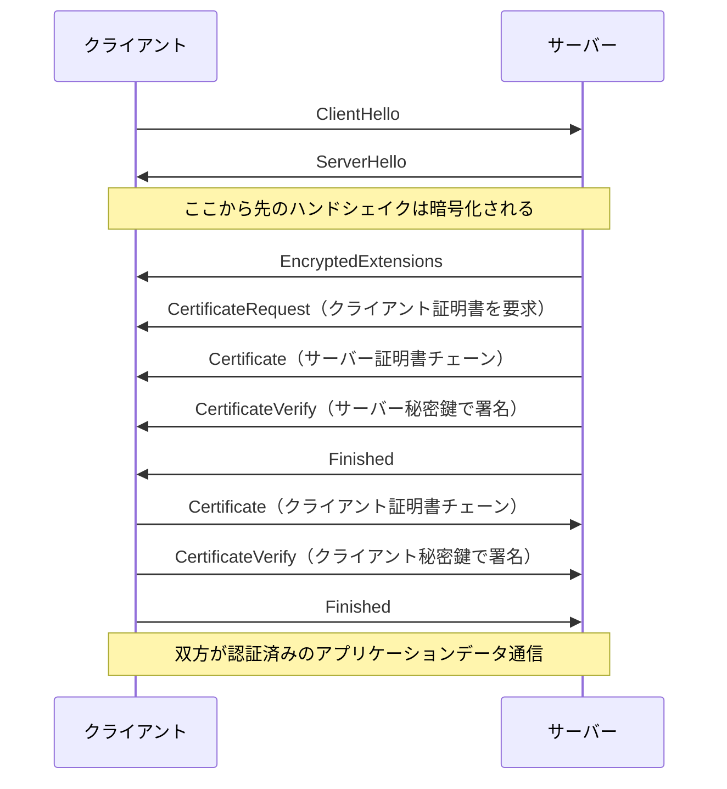

# mTLS

mutual TLS（相互TLS）。通常のTLSではサーバーだけが証明書を提示してクライアントがそれを検証する（片方向認証）が、mTLSではクライアントも証明書を提示し、サーバーがそれを検証する。接続の両端がお互いを認証する。

新しいプロトコルではなく、TLSにもともと仕様として入っている「クライアント認証」を有効にした状態を指す呼び名。TLS 1.3（RFC 8446）ではサーバーが `CertificateRequest` を送ることでクライアント認証が始まる。

## 通常のTLSとの違い

| | 通常のTLS | mTLS |
|---|---|---|
| サーバー証明書 | 提示・検証される | 提示・検証される |
| クライアント証明書 | なし | 提示・検証される |
| クライアントの認証 | TLSの外（パスワード、Cookie、APIキー、トークンなど） | TLSハンドシェイク内で完結（＋必要ならアプリ層の認証を併用） |
| 主な用途 | 一般的なWebサイト | サービス間通信、B2B API、IoT機器、ゼロトラストアクセス |

ポイントは「TLS接続を張れた時点で、相手が信頼するCAから発行された証明書の秘密鍵を持っていることが確認できている」こと。パスワードやAPIキーのように通信路上を秘密そのものが流れることはなく、送られるのは証明書（公開情報）と秘密鍵による署名だけ。

## ハンドシェイクの流れ（TLS 1.3）



- `CertificateRequest`: サーバーがクライアント認証を求めるメッセージ。受け付けるCA名や署名アルゴリズムなどの条件を伝える。
- `Certificate`（クライアント側）: クライアントの証明書チェーン。
- `CertificateVerify`: それまでのハンドシェイク全体（トランスクリプト）のハッシュに対して、証明書に対応する秘密鍵で署名したもの。これで「証明書を持っているだけでなく、その秘密鍵も持っている」ことを証明する。証明書は公開情報なので、盗み見た証明書を送るだけではなりすませない。
- `Finished`: ハンドシェイク全体の完全性チェック。

### クライアントが証明書を持っていない場合

- クライアントは適切な証明書がなくても、空の `certificate_list` を持つ `Certificate` メッセージを送る（`Finished` も続けて送る）。空であること自体はエラーではない。
- それを受けたサーバーは、クライアント認証なしでハンドシェイクを続行するか、`certificate_required` アラートで中断するかを選べる。
- つまり「証明書必須（strict）」か「あれば検証（optional）」かはサーバー側のポリシー。

### TLS 1.2との違い

- TLS 1.2ではハンドシェイク中の証明書は平文で流れるため、クライアント証明書（＝クライアントの身元）も通信路上の盗聴者から見える。TLS 1.3では `ServerHello` 以降のハンドシェイクが暗号化されるので、クライアント証明書も暗号化された状態で送られる。
- TLS 1.2時代は、接続後にクライアント証明書を要求したい場合（例: 特定のパスにアクセスしたときだけ証明書を求める）に再ネゴシエーションを使っていた。TLS 1.3では再ネゴシエーションが廃止され、代わりに **post-handshake authentication** が用意された。クライアントが `post_handshake_auth` 拡張で対応を表明していれば、サーバーはハンドシェイク完了後に `CertificateRequest` を送れる。

## 信頼の仕組み: 誰がクライアント証明書を発行するのか

- サーバー証明書は通常、公的なCA（Webブラウザが信頼するCA）が発行する。
- クライアント証明書は、多くの場合 **組織が自前で運用するプライベートCA** が発行する。サーバーには「このCAが署名した証明書だけを受け入れる」という信頼アンカー（CA証明書）を設定する。
- 検証で見るもの: 証明書チェーンが信頼するCAまで辿れるか、有効期限、失効していないか（CRL/OCSP）、用途（Extended Key Usageの `clientAuth`）など。
- 検証が通ったあと、証明書のSubject（CN）やSAN（URI/DNS名など）を取り出して「どのクライアントか」を識別し、認可判断に使う。mTLSが担うのは **認証（誰か）** までで、**認可（何をしてよいか）** は別途ポリシーで決める必要がある。

## 何を防げるのか

- **なりすまし**: 信頼されたCAが発行した証明書と、その秘密鍵を持たないクライアントは接続できない。
- **認証情報の漏洩・使い回し**: パスワードやAPIキーと違い、秘密鍵はネットワーク上を流れない。
- **中間者攻撃**: サーバー側の検証に加えてクライアント側も検証されるため、どちらの端点に対するなりすましも難しくなる。
- **ブルートフォース/クレデンシャルスタッフィング**: 推測可能な秘密を使わないので成立しにくい。

## 主な利用場面

### サービスメッシュ / マイクロサービス間通信

マイクロサービス同士の通信を全部mTLSにして、「ネットワーク内部にいるから信頼する」のではなく「証明書で身元が確認できた相手だけ信頼する」ゼロトラスト的な構成にする。証明書の発行・ローテーションを人手でやるのは現実的でないので、サービスメッシュが自動化することが多い。

- Istioでは各ワークロード（のEnvoyサイドカー）にメッシュのCAが短命なX.509証明書を発行し、自動でローテーションする。ワークロードのIDはSPIFFE形式（`spiffe://<trust-domain>/ns/<namespace>/sa/<service-account>`）で、Kubernetesのサービスアカウントから導出される。
- `PeerAuthentication` リソースで受信側のmTLSモードを設定する。`PERMISSIVE`（平文とmTLSの両方を受け付ける。デフォルト）と `STRICT`（mTLSのみ）があり、まず `PERMISSIVE` で全トラフィックがmTLS化されたことを確認してから `STRICT` に切り替えるのが一般的な移行手順。

### API保護 / B2B連携

取引先や特定のクライアントにだけ証明書を配布し、APIへのアクセスをその証明書を持つクライアントに限定する。CDN/リバースプロキシ側でmTLSを終端してクライアント証明書を検証する構成もある（例: CloudflareのAPI Shieldでは、ホスト名ごとにmTLSを有効にでき、Cloudflare発行の証明書か自前のCA（BYOCA）を使える）。

### IoT機器

IdPにログインできない機器（センサーなど）に工場出荷時やプロビジョニング時に証明書を埋め込み、それで機器を認証する。

### OAuth 2.0との組み合わせ（RFC 8705）

RFC 8705は、OAuth 2.0でmTLSを使う方法を2つ定義している。

1. **mTLSによるクライアント認証**: トークンエンドポイントでのクライアント認証を、`client_secret` の代わりにmTLSで行う。
   - `tls_client_auth`（PKI方式）: 信頼するCAが発行した証明書で、Subject DNやSANが登録済みの値と一致するかで認証する。
   - `self_signed_tls_client_auth`（自己署名方式）: クライアントが `jwks`/`jwks_uri` で証明書を登録しておき、ハンドシェイクで提示された証明書がそれと一致すれば認証成功。チェーン検証はしない。
2. **証明書バインドアクセストークン**: 発行するアクセストークンにクライアント証明書のSHA-256サムプリントを `cnf` クレームの `x5t#S256` として埋め込む。リソースサーバーは、同じTLS接続で提示された証明書のサムプリントとそれを比較する。これでトークンは「持っていれば誰でも使える」Bearerトークンではなく、対応する秘密鍵を持つクライアントしか使えない proof-of-possession トークンになる。トークンが漏れても、秘密鍵がなければ使えない。

mTLSに対応するエンドポイントを別ホストに分けたい場合は、認可サーバーのメタデータ `mtls_endpoint_aliases` でmTLS用のエンドポイントを別途公開できる。

## 設定例: nginx

```nginx
server {
    listen 443 ssl;
    ssl_certificate         /etc/nginx/server.crt;
    ssl_certificate_key     /etc/nginx/server.key;

    # クライアント証明書の検証に使うCA
    ssl_client_certificate  /etc/nginx/client-ca.crt;
    ssl_verify_client       on;   # on / off / optional / optional_no_ca
    ssl_verify_depth        2;

    location / {
        # 検証結果（SUCCESS / FAILED:reason / NONE）やSubject DNをバックエンドに渡す
        proxy_set_header X-SSL-Client-Verify $ssl_client_verify;
        proxy_set_header X-SSL-Client-DN     $ssl_client_s_dn;
        proxy_pass http://backend;
    }
}
```

- `on`: 証明書必須。
- `optional`: 証明書を要求し、提示されれば検証する。提示されなくても接続は通る（結果は `$ssl_client_verify` で判断）。
- `optional_no_ca`: 証明書を要求するが、信頼するCAによる署名を必須にしない。nginxの外（バックエンドなど）で実際の検証をする前提の設定で、それをしないならセキュリティ上の意味はない。
- `ssl_verify_depth` のデフォルトは1。中間CAを挟む場合は増やす。

## 運用上の難しさ

- **証明書のライフサイクル管理**: 発行・配布・更新・失効をクライアントの数だけ回す必要がある。期限切れは即座に接続不能になるため、短命証明書＋自動ローテーション（サービスメッシュ、SPIFFE/SPIRE、ACMEなど）で回すのが現実的。
- **秘密鍵の保護**: クライアント側に秘密鍵を置くことになるので、その保管（ファイル権限、HSM/TPM、OSのキーストア）が新たな守るべき資産になる。
- **TLS終端の位置**: ロードバランサーやCDNでTLSを終端すると、バックエンドはクライアント証明書を直接見られない。終端点で検証し、結果をヘッダーで渡す（上のnginx例のように）場合、そのヘッダーをクライアントが偽装して送れないようにする必要がある。
- **ブラウザとの相性**: ブラウザでのクライアント証明書は、インストールや選択ダイアログなどUXの負担が大きいので、エンドユーザー向けより機械同士の通信で多く使われる。

## 出典

- [RFC 8446 - The Transport Layer Security (TLS) Protocol Version 1.3](https://datatracker.ietf.org/doc/html/rfc8446)
- [RFC 8446 Errata](https://www.rfc-editor.org/errata/rfc8446)
- [RFC 8705 - OAuth 2.0 Mutual-TLS Client Authentication and Certificate-Bound Access Tokens](https://datatracker.ietf.org/doc/html/rfc8705)
- [Introducing mTLS - Cloudflare Learning Paths](https://developers.cloudflare.com/learning-paths/mtls/concepts)
- [Enable mTLS - Cloudflare SSL/TLS docs](https://developers.cloudflare.com/ssl/client-certificates/enable-mtls/)
- [Mutual TLS - Cloudflare API Shield docs](https://developers.cloudflare.com/api-shield/security/mtls/)
- [ngx_http_ssl_module - nginx](https://nginx.org/en/docs/http/ngx_http_ssl_module.html)
- [Issuing mutual-TLS certificate-bound access tokens - Authlete](https://www.authlete.com/kb/oauth-and-openid-connect/proof-of-possession-pop-tokens/certificate-bound-access-tokens/)
- [Enable Istio Mutual TLS with PeerAuthentication - GoLinuxCloud](https://www.golinuxcloud.com/istio-mtls-kubernetes/)
- [TLS 1.2 vs 1.3 - SSL Dragon](https://www.ssldragon.com/blog/tls-1-2-vs-1-3/)

#tls #security #network #authentication #zero-trust
